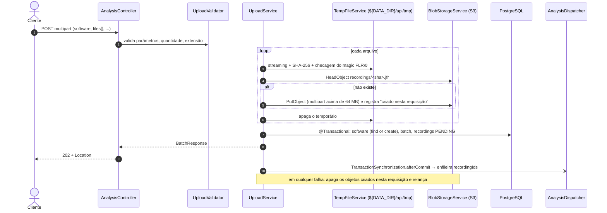
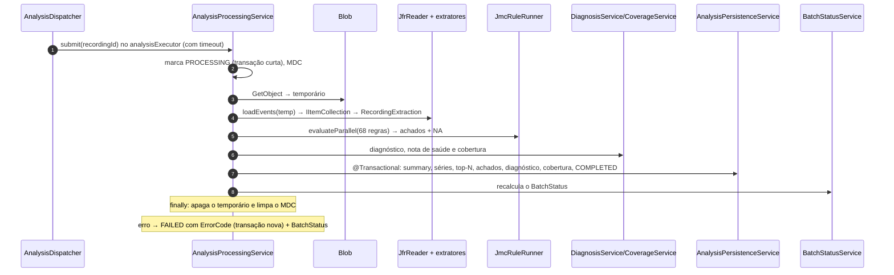

# Plan — JMC AI Analyzer API v0.1.0

| Campo | Valor |
|---|---|
| Versão | 0.1.0 |
| Data | 2026-11-17 |
| Spec | [spec.md](spec.md) |
| Tarefas | [tasks.md](tasks.md) |
| Fonte | Notas Obsidian em `jmc-ai-analyzer-api/v0.1.0/` (02, 05, 07, 08, 09 e 10) |

> Este plano descreve **como** implementar a [spec](spec.md). As decisões estão na §11; qualquer desvio precisa ser **combinado com o autor** antes.

---

## 1. Stack

| Item | Escolha | Observação |
|---|---|---|
| Linguagem | Java 17 | `maven.compiler.release=17` |
| Framework | Spring Boot **4.1.2** | Spring Framework 7, Hibernate 7.4, **Jackson 3** (`tools.jackson.*`) |
| Banco | PostgreSQL 17 | driver gerenciado pelo Boot (42.7.x) |
| Migrações | Flyway 12 | + `flyway-database-postgresql` |
| Leitura JFR | `org.openjdk.jmc:flightrecorder` e `flightrecorder.rules.jdk` **9.1.2** | validado no spike (§10) |
| Blob | SeaweedFS (API S3) | imagem `chrislusf/seaweedfs` com versão fixa |
| Cliente S3 | AWS SDK for Java v2 (`software.amazon.awssdk:s3`) | versão pelo `software.amazon.awssdk:bom` |
| Swagger | `org.springdoc:springdoc-openapi-starter-webmvc-ui` 3.x | versão exata conferida no bootstrap |
| Boilerplate | Lombok 1.18.48 | gerenciado pelo Boot |
| Testes | JUnit 5, Mockito, AssertJ, Awaitility, Testcontainers 2.0.5 | |
| Qualidade | JaCoCo, `sonar-maven-plugin` | SonarQube existente |
| Container | Docker + Compose | bind mounts em `${DATA_DIR}` |

### 1.1. Dependências Maven (Spring Boot 4.1.2)

> Os nomes dos starters foram conferidos no Maven Central para a 4.1.2. Não use os nomes do Boot 3.

| Escopo | Artefato |
|---|---|
| compile | `spring-boot-starter-webmvc`, `spring-boot-starter-data-jpa`, `spring-boot-starter-validation`, `spring-boot-starter-flyway`, `spring-boot-starter-actuator` |
| compile | `org.flywaydb:flyway-database-postgresql`, `org.postgresql:postgresql` (runtime) |
| compile | `org.openjdk.jmc:flightrecorder.rules.jdk:9.1.2` (traz `flightrecorder`, `flightrecorder.rules` e `common`) |
| compile | `software.amazon.awssdk:s3` (BOM `software.amazon.awssdk:bom`) |
| compile | `org.springdoc:springdoc-openapi-starter-webmvc-ui` 3.x |
| provided | `org.projectlombok:lombok` (também em `annotationProcessorPaths`) |
| test | `spring-boot-starter-webmvc-test`, `spring-boot-starter-data-jpa-test`, `spring-boot-starter-flyway-test`, `spring-boot-testcontainers`, `org.testcontainers:testcontainers-postgresql`, `org.testcontainers:testcontainers-junit-jupiter`, `org.awaitility:awaitility` |

### 1.2. Plugins

- `maven-compiler-plugin` com `annotationProcessorPaths` do Lombok.
- `jacoco-maven-plugin` (§9.2).
- `sonar-maven-plugin` (§9.3).
- `spring-boot-maven-plugin`.

O `pom.xml` também preenche `name`, `description` e `sonar.projectKey`, que hoje estão vazios.

---

## 2. Estrutura de pacotes

```text
io.github.maiconthales.jmc_ai_analyzer_api
├── JmcAiAnalyzerApiApplication.java      (@SpringBootApplication, @EnableScheduling, @ConfigurationPropertiesScan)
├── system
│   ├── config         @Configuration: AsyncConfig, BlobStorageConfig, ClockConfig, OpenApiConfig, WebConfig
│   ├── properties     @ConfigurationProperties: UploadProperties, AnalysisProperties, BlobProperties,
│   │                  StorageProperties, RetentionProperties, DiagnosisProperties
│   ├── controllers    AnalysisController, RecordingController, SoftwareController
│   ├── dto            DTOs HTTP: BatchResponse, RecordingStatusResponse, SoftwareResponse, SoftwareUpdateRequest,
│   │   │              UploadRequest, HistoryItemResponse, DashboardDtos
│   │   ├── jfr        RecordingExtraction, RecordingMetadata, DomainResults, RecordingSettings, ExtractionContext,
│   │   │              TimedValue, JmcRulesResult, NotApplicableRule
│   │   ├── diagnosis  DiagnosisContext, DiagnosisOutcome, CoverageResult, CoverageDomainSpec, JmcTranslation
│   │   ├── dashboard  RecordingDataSet, ConsolidationInput
│   │   └── processing ProcessingTarget, StoredFile, RecordingsUploadedEvent, BlobObject, RetentionResult
│   ├── exceptions     ApiException (base, com ErrorCode), NotFoundException, NotReadyException,
│   │                  InvalidUploadException, StorageUnavailableException, BlobNotFoundException,
│   │                  JfrParseException, AnalysisInterruptedException
│   ├── handlers       ApiExceptionHandler (@RestControllerAdvice → ProblemDetail)
│   ├── components     @Component: UploadValidator, AnalysisDispatcher, RecoveryRunner, RetentionJob,
│   │   │              BlobStorageHealthIndicator
│   │   ├── jfr        RecordingAnalyzer, JmcRuleRunner
│   │   ├── dashboard  RecordingDataLoader, AppFrameResolver
│   │   └── diagnosis  JmcFindingTranslator, DiagnosisRule (interface)
│   │       └── rules  HeapPressureRule, GcPauseHighRule, AllocationRateHighRule, CpuSaturationRule,
│   │                  HotMethodDominantRule, LockContentionRule, ExceptionRateHighRule, SlowRemoteCallRule,
│   │                  ThreadGrowthRule, TieredStopLevelRule, ActiveProcessorCountRule, XmsXmxMismatchRule,
│   │                  RecordingCoverageRule
│   ├── mapper         BatchMapper, SummaryMapper, DashboardMapper
│   ├── services       somente *Service (@Service): UploadService, BatchCreationService, BlobStorageService,
│   │   │              TempFileService, SoftwareService, RecordingStateService, BatchStatusService,
│   │   │              BatchQueryService, HistoryService, AnalysisProcessingService, AnalysisPersistenceService
│   │   ├── dashboard  DashboardService, ConsolidationService
│   │   └── diagnosis  DiagnosisService, CoverageService
│   ├── utils          utilitários estáticos, sem estado
│   │   ├── jfr        EventView, JfrEvents, JfrFields, JfrEventTypes, StackFrames, FrameCounter,
│   │   │   │          SeriesDownsampler, Stats, JvmArgsParser, JmcMessageFormatter
│   │   │   └── extractors  MetadataExtractor, CpuExtractor, HeapExtractor, GcExtractor, ThreadExtractor,
│   │   │                   LockExtractor, HotMethodExtractor, AllocationExtractor, ExceptionExtractor,
│   │   │                   IoExtractor, LeakExtractor, ThreadCpuExtractor, SettingsExtractor
│   │   └── diagnosis  AppFrames, Diagnoses, HealthScoreCalculator
│   ├── enums          AnalysisStatus, BatchStatus, MetricType, LockType, IoType, FindingSeverity, Priority,
│   │                  DiagnosisCategory, CoverageStatus, CoverageDomain, Environment, ErrorCode
│   ├── entity         entidades JPA (§4)
│   └── repository     Spring Data JPA
├── mcp                só package-info.java (WIP)
└── ia                 só package-info.java (WIP)
```

**Regras de organização (D-18)**:
- `properties` só tem `*Properties`; `config` só tem `@Configuration`.
- `dto`, `exceptions`, `components` e `mapper` ficam no mesmo nível de `controllers`.
- Toda classe com `Exception` no nome que seja uma exceção fica em `exceptions`. O `ApiExceptionHandler` é um handler e fica em `handlers`.
- `services` só tem classes `*Service` anotadas com `@Service`.
- Toda classe `@Component` fica em `components`; todo `*Mapper` fica em `mapper`.
- Records internos (modelos de extração, diagnóstico, dashboard e processamento) ficam em subpacotes de `dto`; utilitários estáticos ficam em `utils`.
- Subpacotes por assunto são permitidos (`jfr`, `diagnosis`, `dashboard`, `processing`).

**Convenções**:
- injeção por construtor (`@RequiredArgsConstructor`);
- entidades nunca saem dos controllers, sempre passam por um mapper para DTO;
- cada extrator e cada regra é uma classe pequena e pura, testável sem Spring;
- complexidade cognitiva ≤ 15 por método.

---

## 3. Fluxos

### 3.1. Upload



### 3.2. Processamento



- **Timeout**: o `Future` do executor é aguardado por um supervisor com `get(timeout)`. Se estourar, faz `cancel(true)` e marca `FAILED/TIMEOUT`. O processamento verifica `Thread.interrupted()` entre os extratores.
- **Fila**: `ThreadPoolTaskExecutor` com `corePoolSize = maxPoolSize = app.analysis.max-concurrent` e fila sem limite (os itens pendentes estão também no banco).
- **Retomada** (`RecoveryRunner`, um `ApplicationRunner`): coloca `PROCESSING` → `PENDING` e reenvia todos os `PENDING`. Também limpa `${tmp}` de arquivos com mais de 1 h.
- **Determinismo**: o processamento usa `Locale.ROOT` nos textos internos, e a formatação das mensagens do JMC é feita com locale `en` e fuso UTC.
- **Logs**: logger `org.openjdk.jmc` em `ERROR` (o aviso `virtual` é inofensivo).

### 3.3. Consulta do dashboard

O `DashboardService` carrega a gravação e os filhos com consultas por `recording_id` e `rank <= topN`. Em seguida, o `AppFrameResolver` calcula o `appFrame` de cada item a partir de `stack_frames` e dos `appPackages` do software. O consolidado (`ConsolidationService`) faz o mesmo para todas as gravações `COMPLETED` do lote e aplica as regras de RF-06 em memória, usando os 50 itens persistidos por gravação.

### 3.4. Retenção

O `RetentionJob` roda com `@Scheduled(cron = "${app.retention.cron}")`:

1. Para cada software, apaga os lotes não-`PROCESSING` com `created_at < now() − retention_days`. A exclusão é em lote, por `id`, e a cascata no banco remove os filhos.
2. Seleciona os `sha256` que estavam nessas gravações e não aparecem em nenhuma `jfr_recording` restante, e apaga os objetos do blob. Se o blob falhar, registra `WARN` e o objeto será tentado de novo na próxima execução (a seleção usa uma comparação com a listagem `ListObjectsV2` do prefixo `recordings/`).
3. Registra os contadores por software no log.

---

## 4. Modelo de dados

### 4.1. Tabelas

| Tabela | Colunas principais | Observações |
|---|---|---|
| `software` | `id uuid PK`, `name varchar(64) UK`, `retention_days int CHECK > 0`, `app_packages text`, `created_at`, `updated_at` | |
| `analysis_batch` | `id uuid PK`, `software_id FK RESTRICT`, `software_version varchar(64)`, `environment varchar(8)`, `description varchar(500)`, `status`, `file_count`, `created_at`, `finished_at` | |
| `jfr_recording` | `id uuid PK`, `batch_id FK CASCADE`, `original_name`, `blob_bucket`, `blob_key`, `sha256 char(64)`, `size_bytes`, `status`, `error_code`, `error_message`, `parser_version`, `recording_start`, `recording_end`, `duration_ms`, `event_count`, `jvm_name`, `jvm_version`, `jvm_args`, `java_args`, `os_name`, `cpu_cores`, `physical_memory_bytes`, `processing_started_at`, `processing_finished_at`, `created_at` | |
| `recording_summary` | `recording_id PK/FK`, CPU (avg/max JVM e máquina), heap (inicial, máximo, pico), coletores, GC (count, total, avg, p95, max, pct), threads (peak, daemon_peak, started, ended), `throwables_total`, `allocation_rate_bytes_s`, `execution_samples_total`, `domains_available`, `health_score` | 1:1 |
| `metric_sample` | `id`, `recording_id`, `metric`, `ts`, `avg_value`, `max_value` | séries |
| `gc_pause` | `id`, `recording_id`, `rank`, `gc_id`, `collector`, `cause`, `start_time`, `duration_ms` | top-N |
| `hot_method` | `id`, `recording_id`, `rank`, `method_signature`, `samples`, `percent`, `stack_frames jsonb` | top-N |
| `lock_contention` | `id`, `recording_id`, `rank`, `lock_type`, `class_name`, `event_count`, `total_ms`, `max_ms`, `stack_frames jsonb` | top-N |
| `allocation_hotspot` | `id`, `recording_id`, `rank`, `class_name`, `weight_bytes`, `samples`, `stack_frames jsonb` | top-N |
| `exception_hotspot` | `id`, `recording_id`, `rank`, `exception_class`, `event_count`, `sample_message varchar(500)`, `stack_frames jsonb` | top-N |
| `io_hotspot` | `id`, `recording_id`, `rank`, `io_type`, `target`, `bytes`, `event_count`, `total_ms` | top-N |
| `leak_suspect` | `id`, `recording_id`, `rank`, `class_name`, `samples`, `max_age_ms`, `max_array_size`, `stack_frames jsonb` | top-N |
| `thread_cpu` | `id`, `recording_id`, `rank`, `thread_name`, `cpu_avg`, `cpu_max` | top-N |
| `rule_finding` | `id`, `recording_id`, `rule_id`, `rule_name`, `topic`, `severity`, `score`, `summary`, `explanation`, `solution` | |
| `diagnosis_item` | `id`, `recording_id`, `priority`, `category`, `source`, `score`, `title`, `evidence`, `location jsonb`, `action`, `domain_ref` | |
| `coverage_item` | `id`, `recording_id`, `domain`, `status`, `reason`, `recommendation` | + `suggested_command` em `recording_summary` |

> `diagnosis_item.location` passa a ser `jsonb` (`{thread?, target?, stackFrames?}`), em vez do `text` da nota 05, para guardar a pilha que o `AppFrameResolver` precisa. Essa é a única mudança em relação às notas.

### 4.2. Regras

- `uuid` em `software`, `analysis_batch` e `jfr_recording`. As tabelas filhas usam `bigint` com **sequência** (`allocationSize = 50`) para permitir JDBC batch (`hibernate.jdbc.batch_size=500`, `order_inserts=true`).
- Todas as FKs filhas usam `ON DELETE CASCADE`; `analysis_batch.software_id` usa `RESTRICT`.
- Enums gravados como `varchar` com `@Enumerated(STRING)` e `CHECK` no banco.
- `jsonb` mapeado com `@JdbcTypeCode(SqlTypes.JSON)` para `List<StackFrame>` (record).
- Índices:
  - `jfr_recording(batch_id)`, `(status)` e `(sha256)`;
  - `metric_sample(recording_id, metric, ts)`;
  - `(recording_id, rank)` nas tabelas de top-N;
  - `rule_finding(recording_id, severity)`, `diagnosis_item(recording_id, priority)`;
  - `analysis_batch(software_id, created_at desc)` e `(created_at desc)`.
- **Gravação atômica**: um único `@Transactional` no `AnalysisPersistenceService`.

### 4.3. Migrações Flyway

| Versão | Conteúdo |
|---|---|
| `V1__create_software_batch_and_recording.sql` | `software`, `analysis_batch`, `jfr_recording` e sequências |
| `V2__create_summary_and_series.sql` | `recording_summary`, `metric_sample` |
| `V3__create_hotspots.sql` | `gc_pause`, `hot_method`, `lock_contention`, `allocation_hotspot`, `exception_hotspot`, `io_hotspot` |
| `V4__create_rule_finding.sql` | `rule_finding` |
| `V5__create_leak_and_thread_cpu.sql` | `leak_suspect`, `thread_cpu` |
| `V6__create_diagnosis_and_coverage.sql` | `diagnosis_item`, `coverage_item` |

---

## 5. Extração JFR — detalhes de implementação

- `JfrReader`: `JfrLoaderToolkit.loadEvents(File)`. Exceções de parse viram `PARSE_ERROR`.
- Os extratores recebem `IItemCollection` e usam `ItemFilters.type(...)` e `JdkAttributes`/`JdkFilters` do JMC. Sem eventos, devolvem `available = false`.
- `SeriesDownsampler`: divide `[início, fim]` em `max-series-points` janelas iguais e guarda `avg` e `max` de cada uma; janelas vazias são omitidas.
- `TopNAccumulator<K>`: agrega por chave e mantém os `persisted-top-n` maiores.
- `StackFrameCollector`: conta as pilhas (5 frames) por chave e guarda a mais frequente.
- `JvmArgsParser`: lê `jvmArguments` respeitando a **última ocorrência** de cada flag (`-XX:TieredStopAtLevel`, `-XX:ActiveProcessorCount`, `-Xms`, `-Xmx`) e extrai a versão do jar de `javaArguments` para o `SoftwareVersionResolver`.
- **GC p95**: ordenar as durações e pegar o índice `ceil(0,95 × n) − 1`.
- **Exceções**: `throwablesTotal` = último `throwables` − primeiro de `jdk.ExceptionStatistics`.
- **Dados sensíveis** (RNF-10): `jdk.InitialEnvironmentVariable`, `jdk.InitialSystemProperty` e `jdk.SystemProcess` nunca são lidos pelos extratores.

### 5.1. Regras do JMC

```java
Collection<IRule> rules = RuleRegistry.getRules();                     // 68 regras na 9.1.2
Map<IRule, Future<IResult>> results =
    RulesToolkit.evaluateParallel(rules, items, IPreferenceValueProvider.DEFAULT_VALUES, threads);
// para cada resultado:
//   severidade: NA | OK | INFO | WARNING | IGNORE
//   score:      result.getResult(TypedResult.SCORE)          (pode ser null)
//   textos:     ResultToolkit.populateMessage(result, result.getSummary() / getExplanation() / getSolution(), false)
//   NA:         rule.getRequiredEvents(), result.suggestRecordingSettings() → CoverageService
```

- `JmcMessageFormatter`: chama `populateMessage` e sanitiza o HTML, mantendo `<p>`, `<ul>`, `<li>`, `<b>` e `<code>`. A sanitização é feita com uma lista de tags permitidas implementada no projeto, sem dependência nova; se o autor preferir, dá para usar `org.owasp.html` (decisão a combinar).
- `threads` = `min(2, núcleos disponíveis)`, para não competir com o executor de análise.

### 5.2. Diagnóstico e cobertura

- `DiagnosisContext` (record): extração, achados do JMC, cobertura, `environment` e núcleos.
- Cada `DiagnosisRule` implementa `Optional<DiagnosisItemData> evaluate(DiagnosisContext ctx, DiagnosisProperties props)`.
- O `DiagnosisService` aplica, em ordem:
  1. converte os achados `INFO` e `WARNING` do JMC em itens, com o `JmcFindingTranslator`;
  2. executa as regras próprias;
  3. ordena;
  4. calcula a nota com o `HealthScoreCalculator`.
- O `CoverageService` monta um item por `CoverageDomain`:
  - `AUSENTE` se o evento estiver desabilitado em `jdk.ActiveSetting` (o JMC resolve o id numérico para o tipo de evento) ou se não houver ocorrências;
  - `INSUFICIENTE` abaixo dos mínimos de `app.diagnosis.coverage.*`;
  - as recomendações vêm de uma tabela fixa por domínio e de `suggestRecordingSettings()`.
- O `appFrame` **não** é persistido; é resolvido na consulta (§3.3).

### 5.3. Propriedades `app.diagnosis.*` (padrões)

```yaml
app:
  diagnosis:
    priority-score: { alta: 80, media: 50, baixa: 15 }
    health-weights: { alta: 20, media: 8, baixa: 2 }
    framework-packages: [java., javax., jdk., sun., com.sun., org.springframework., org.apache., io.netty.]
    heap-pressure-pct: 85
    gc-pause-max-ms: 200
    gc-pause-pct: 5
    allocation-rate-bytes-s: 1073741824
    cpu-saturation-pct: 90
    cpu-saturation-time-pct: 10
    hot-method-pct: 20
    lock-time-pct: 1
    exception-rate-per-s: 100
    slow-socket-read-ms: 1000
    thread-growth-ratio: 2
    xms-xmx-min-ratio: 0.5
    coverage:
      min-execution-samples: 1000
      min-duration: 5m
```

---

## 6. Blob storage

- **`S3Client`**:
  - `endpointOverride(app.blob.endpoint)`, `forcePathStyle(true)`, região `us-east-1`;
  - credenciais estáticas vindas de `app.blob.access-key` e `secret-key`;
  - `requestChecksumCalculation(WHEN_REQUIRED)` e `responseChecksumValidation(WHEN_REQUIRED)`, porque o SeaweedFS rejeita os checksums padrão do SDK 2.30+.
- **`BlobStorageService`**: `ensureBucket()` (na inicialização), `exists`, `upload` (multipart acima de 64 MB), `downloadToTempFile`, `delete` e `listKeys(prefix)`.
- **Erros**: `SdkClientException`/5xx → `StorageUnavailableException`; `NoSuchKeyException` → `BLOB_NOT_FOUND`.
- **`BlobStorageHealthIndicator`**: `HeadBucket`.

---

## 7. API — implementação

- Controllers só traduzem HTTP ↔ serviço; DTOs são `record`s em `dto`.
- Validação com Bean Validation (`@Pattern` para o software, `@Min`/`@Max` para `topN` e `retentionDays`), mapeada para `INVALID_PARAMETER`.
- **`ApiExceptionHandler`** devolve `ProblemDetail` com a propriedade `code` e trata:
  - `ApiException` (com `ErrorCode`);
  - `MaxUploadSizeExceededException` → `FILE_TOO_LARGE`;
  - `MethodArgumentNotValidException`, `ConstraintViolationException`, `MethodArgumentTypeMismatchException` e `MissingServletRequestPartException` → `INVALID_PARAMETER` ou `EMPTY_UPLOAD`;
  - `Exception` → `INTERNAL_ERROR`, com log do erro e corpo sem detalhes.
- **Paginação**: `@EnableSpringDataWebSupport(pageSerializationMode = VIA_DTO)`; `size` máximo 100.
- **Multipart**: `spring.servlet.multipart.max-file-size`, `max-request-size`, `file-size-threshold=0`, `location=${app.storage.tmp-dir}` e `server.tomcat.max-swallow-size=-1`.
- **Swagger**: `OpenApiConfig` com título, versão e um exemplo `problem+json` reutilizável.

---

## 8. Infraestrutura

### 8.1. Dockerfile (multi-stage)

1. **build**: `maven:3.9-eclipse-temurin-17`; `mvn -B dependency:go-offline` em camada separada; `mvn -B -DskipTests package`.
2. **runtime**: `eclipse-temurin:17-jre`; usuário com `APP_UID`/`APP_GID`; diretórios `/app/logs` e `/app/tmp`; `HEALTHCHECK` com `/actuator/health`; `ENTRYPOINT java $JAVA_OPTS -jar app.jar`.

### 8.2. `docker-compose.yml`

| Serviço | Imagem | Portas | Bind mounts | Health |
|---|---|---|---|---|
| `postgres` | `postgres:17-alpine` | — | `${DATA_DIR}/postgres:/var/lib/postgresql/data` | `pg_isready` |
| `blob` | `chrislusf/seaweedfs:<fixa>` | — (8333 interna) | `${DATA_DIR}/seaweedfs:/data`, `./docker/seaweedfs/s3.json:/etc/seaweedfs/s3.json:ro` | definido em T-02.2 |
| `api` | build | `8080:8080` | `${DATA_DIR}/api/logs:/app/logs`, `${DATA_DIR}/api/tmp:/app/tmp` | `/actuator/health` |
| `mcp`, `frontend` | — | — | `${DATA_DIR}/<serviço>/` | blocos comentados (WIP) |

- `api` usa `depends_on` com `condition: service_healthy` para `postgres` e `blob`, e limite de memória `${API_MEMORY_LIMIT:-3g}`.
- **Sem *named volumes*.** `docker-data/` e `.env` ficam no `.gitignore`.
- `docker-compose.debug.yml` (opcional) expõe 5432 e 8333 em `127.0.0.1`.
- `scripts/init-data-dirs.sh` cria a árvore de `${DATA_DIR}` com as permissões certas.
- `scripts/render-s3-config.sh` gera `docker/seaweedfs/s3.json` a partir do `.env`; o repositório versiona só o `s3.json.example`.
- Logs da API em `/app/logs` (logback com rotação diária, 14 dias) e também no stdout.

### 8.3. Variáveis de ambiente (`.env.example`)

```dotenv
DATA_DIR=./docker-data
APP_UID=1000
APP_GID=1000
POSTGRES_DB=jmc_analyzer
POSTGRES_USER=jmc
POSTGRES_PASSWORD=change-me
SPRING_DATASOURCE_URL=jdbc:postgresql://postgres:5432/jmc_analyzer
BLOB_ENDPOINT=http://blob:8333
BLOB_BUCKET=jfr-recordings
BLOB_ACCESS_KEY=change-me
BLOB_SECRET_KEY=change-me
APP_TMP_DIR=/app/tmp
APP_UPLOAD_MAX_FILES=20
APP_UPLOAD_MAX_FILE_SIZE=128MB
APP_UPLOAD_MAX_REQUEST_SIZE=1GB
APP_ANALYSIS_MAX_CONCURRENT=2
APP_ANALYSIS_TIMEOUT=10m
APP_RETENTION_DEFAULT_DAYS=90
APP_RETENTION_CRON=0 0 3 * * *
API_MEMORY_LIMIT=3g
JAVA_OPTS=-XX:MaxRAMPercentage=75
```

### 8.4. Profiles

- `default`: execução local, com Postgres e SeaweedFS do Compose expostos pelo override de debug.
- `docker`: hosts internos do Compose.
- Testes usam `@ServiceConnection` (PostgreSQL) e `@DynamicPropertySource` (SeaweedFS).

---

## 9. Qualidade

### 9.1. Testes

| Camada | Ferramenta | Cobre |
|---|---|---|
| Extratores e suporte | JUnit, sem Spring | cada domínio com os 3 arquivos de `examples files/` (copiados para `src/test/resources/jfr/`); domínio ausente; downsampling; top-N; parser de flags |
| Domínios ausentes nos exemplos | `jdk.jfr.Recording` no teste | `JavaExceptionThrow`, `FileRead`/`FileWrite`, `JavaMonitorEnter` com contenção |
| Regras JMC | JUnit | `populateMessage`, sanitização, score nulo, determinismo de locale |
| Diagnóstico e cobertura | JUnit | cada regra (dispara e não dispara), traduções, nota de saúde, ordenação, CA-14 |
| Serviços | JUnit + Mockito | upload (tudo ou nada, deduplicação), status do lote, timeout, retomada, consolidação, `AppFrameResolver`, retenção |
| Controllers | `@WebMvcTest` + MockMvc | contratos, códigos HTTP, `problem+json` |
| Persistência | `@DataJpaTest` + Testcontainers PostgreSQL | migrações, `CHECK`, cascata, `jsonb`, consultas |
| Blob | Testcontainers SeaweedFS (`GenericContainer`) | bucket, put/head/get/delete, checksum `WHEN_REQUIRED` |
| Integração | `@SpringBootTest` + PostgreSQL + SeaweedFS | upload → `COMPLETED` → dashboards → retenção (CA-01, 02, 05, 13, 14, 15, 18) |
| Compose | script manual | CA-06 (`down -v` + `up`) |

Arquivos de falha: um `.jfr` truncado (gerado no teste a partir de um exemplo) e um arquivo com magic inválido.

### 9.2. JaCoCo

- Goals `prepare-agent`, `report` e `check` na fase `verify`.
- Regra `BUNDLE` com `LINE ≥ 0.90` e `BRANCH ≥ 0.90`.
- Exclusões:
  - `JmcAiAnalyzerApiApplication`;
  - `**/mcp/**` e `**/ia/**`;
  - `**/properties/**`.
- `lombok.config` com `lombok.addLombokGeneratedAnnotation = true` e `config.stopBubbling = true`.

### 9.3. Sonar

- `sonar.projectKey` no `pom.xml`.
- `sonar.coverage.jacoco.xmlReportPaths=target/site/jacoco/jacoco.xml`.
- `sonar.coverage.exclusions` iguais às do JaCoCo.
- `sonar.qualitygate.wait=true`.
- Execução local, sem CI:
  ```bash
  mvn clean verify sonar:sonar -Dsonar.host.url=$SONAR_HOST_URL -Dsonar.token=$SONAR_TOKEN
  ```

---

## 10. Spike já executado (2026-11-17)

| Item | Resultado |
|---|---|
| JMC 9.1.2 em Java 17 | ok (bytecode 61) |
| Arquivos de exemplo | 3 × ~1,5 MB, 60 s, HotSpot 21.0.12 no Windows, 6 núcleos, Spring + Kafka |
| Regras | 68 executadas em ~200 ms por arquivo |
| Heap | ~30 MB para um arquivo de 1,5 MB (~20×), **estimativa** |
| Severidades | `NA`, `OK`, `INFO`, `WARNING`, `IGNORE` |
| Mensagens | placeholders exigem `ResultToolkit.populateMessage`; HTML; inglês; dependem do locale |
| Eventos ausentes | `JavaExceptionThrow`, `FileRead`, `FileWrite`; `ExecutionSample` com só ~220–260 em 60 s |
| Eventos extras úteis | `OldObjectSample`, `ThreadCPULoad`, `SafepointBegin`, `NativeMethodSample` |
| Dados sensíveis | `InitialEnvironmentVariable`, `InitialSystemProperty`, `SystemProcess` |

### 10.1. Medições feitas na implementação

| Item | Resultado |
|---|---|
| SeaweedFS (T-02.2) | imagem fixada em `chrislusf/seaweedfs:4.52`; `server -s3 -dir=/data -s3.config=... -ip.bind=0.0.0.0`; health em `GET :8333/healthz`; envio simples, multipart, listagem e exclusão validados com o AWS SDK v2 (`WHEN_REQUIRED`) |
| Memória (T-02.3) | gravações reais densas de ~240 MB: **1–1,5 GB de heap** (3–5× o arquivo), 3–5 s de processamento. A estimativa de 20× vinha do arquivo de 1,5 MB, dominado por custo fixo |
| Concatenação de `.jfr` | não serve para medir: o JMC descarta chunks repetidos |

**Decisão do autor (2026-11-17)**: manter **128 MB** por arquivo e reduzir `API_MEMORY_LIMIT` para **3 GB** (heap de ~2,25 GB com `MaxRAMPercentage=75`: até 2 arquivos de 128 MB em paralelo, ~0,8 GB cada, mais a aplicação).

### 10.2. Ajustes feitos durante a implementação

- `io_hotspot.max_ms`: nova coluna, necessária para a regra `SLOW_REMOTE_CALL` (leitura > 1 s).
- `sha256` como `VARCHAR(64)` (o `CHAR` não valida no Hibernate).
- Health check do container com uma classe Java compilada no build (a imagem JRE não tem curl nem compilador).
- Locale `en_US` e fuso UTC fixados no `main`, no Dockerfile e no Surefire (mensagens do JMC determinísticas).
- Objetos órfãos do blob só são apagados pela retenção depois de 1 h, para não atingir um upload em andamento.

---

## 11. Decisões

| # | Decisão | Motivo |
|---|---|---|
| D-01 | Parser JFR no back-end com o JMC 9.1.2 | traz regras automáticas; o MCP volta no futuro |
| D-02 | Agregados + séries reduzidas + top-N | banco enxuto; o detalhe fica no `.jfr` |
| D-03 | `.jfr` no SeaweedFS (S3) | reprocessamento futuro; API sem estado; servidor S3 trocável |
| D-04 | Consolidado calculado na consulta | nunca fica desatualizado |
| D-05 | DTOs em `dto` (substituída pela D-18) | — |
| D-06 | Spring Boot 4.1.2 | mantido do `pom.xml` |
| D-07 | Processamento assíncrono | arquivos grandes; evitar timeout HTTP |
| D-08 | SDD em `.spec/0.1.0/` na raiz do repositório | histórico do projeto |
| D-09 | Todo dado de container em bind mount | nada se perde ao recriar |
| D-10 | SonarQube local, sem CI | resposta do autor |
| D-11 | Limites 20 / 128 MB / 1 GB / 3 GB | medição: heap de 3–5× o arquivo (T-02.3) |
| D-12 | Software obrigatório + retenção em dias por software | resposta do autor |
| D-13 | Swagger na v0.1.0 | resposta do autor |
| D-14 | Fixtures = `examples files/` + gravações sintéticas | resposta do autor |
| D-15 | Severidades do JMC sem `CRITICAL` | resultado do spike |
| D-16 | P-01, P-02, P-03, P-04, P-05a, P-05b e P-07 na v0.1.0 | aprovação do autor |
| D-17 | `diagnosis_item.location` como `jsonb` | precisa guardar a pilha para o `appFrame` |
| D-18 | Pacotes `properties`, `dto`, `exceptions`, `components`, `mapper`, `services` (só `*Service`) e `utils` no mesmo nível de `controllers` | pedido do autor em 2026-11-17 |

## 12. Riscos

| Risco | Mitigação |
|---|---|
| Memória do parser em arquivos grandes | T-02.3 mede antes de fechar os limites; `max-concurrent` configurável |
| Mudança de API do JMC em versões futuras | isolar o uso em `jfr.rules` e `jfr.extractors`; testes com fixtures reais |
| SeaweedFS com comportamento S3 diferente | teste de integração dedicado; acesso só pelo `BlobStorageService` |
| Cobertura de 90% de branches nos extratores | extratores pequenos e fixtures sintéticas para os ramos de "evento ausente" |
| `springdoc` 3.x incompatível com o Boot 4.1.2 | conferir no bootstrap (T-01.2); se falhar, avisar o autor antes de trocar |
