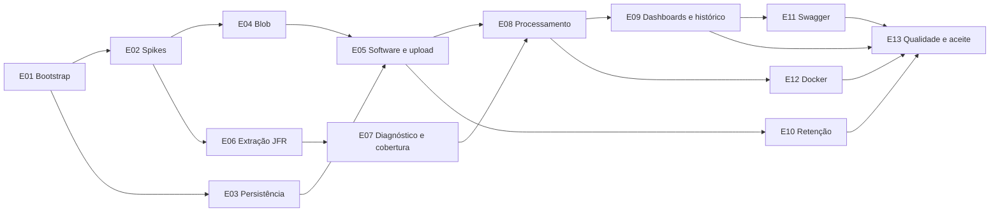

# Tasks — JMC AI Analyzer API v0.1.0

| Campo | Valor |
|---|---|
| Versão | 0.1.0 |
| Data | 2026-11-17 |
| Spec | [spec.md](spec.md) |
| Plano | [plan.md](plan.md) |

## Como usar

- Cada tarefa tem um id `T-EE.N`, as dependências (**Dep**) e o **Pronto quando**.
- Toda tarefa de código só está pronta com testes, cobertura mantida ≥ 90% e nenhuma issue Sonar nova *Blocker*, *Critical* ou *Major*.
- Marque `[x]` ao concluir. Em caso de dúvida, **pergunte ao autor** antes de decidir.
- `CA-xx` são os critérios de aceite da spec (§7).

## Ordem dos épicos

---

## E01 — Bootstrap

- [x] **T-01.1 — Estrutura de pacotes e WIP**
  - Criar `system/{config,controllers,handlers,enums,entity,repository,service}` conforme a necessidade.
  - Criar `mcp/package-info.java` e `ia/package-info.java` com Javadoc "WIP", descrevendo o papel futuro de cada um.
  - **Dep**: — · **Pronto quando**: CA-09.
- [x] **T-01.2 — `pom.xml`**
  - Dependências e plugins do plan §1.1 e §1.2; preencher `name` e `description`.
  - Confirmar a versão do `springdoc-openapi-starter-webmvc-ui` 3.x compatível com o Boot 4.1.2. Se nenhuma for compatível, **avisar o autor**.
  - **Dep**: — · **Pronto quando**: `mvn -q compile` passa.
- [x] **T-01.3 — Qualidade no build**
  - JaCoCo com `check` (90% de linhas e de branches) e exclusões do plan §9.2.
  - `sonar-maven-plugin` e as propriedades do plan §9.3.
  - `lombok.config`.
  - **Dep**: T-01.2 · **Pronto quando**: `mvn verify` executa o `check`.
- [x] **T-01.4 — Configuração**
  - `application.yml` (default e profile `docker`), com multipart, logger `org.openjdk.jmc=ERROR` e Jackson.
  - Properties: `Upload`, `Analysis`, `Blob`, `Storage`, `Retention` e `Diagnosis` (records `@Validated`, com os padrões do plan §5.3 e §8.3).
  - **Dep**: T-01.2 · **Pronto quando**: o contexto sobe; teste das validações das properties.
- [x] **T-01.5 — Enums e erros**
  - Todos os enums do plan §2.
  - `ErrorCode`, `ApiException` e subclasses.
  - `ApiExceptionHandler` com `ProblemDetail` e a propriedade `code`, conforme o plan §7.
  - **Dep**: T-01.2 · **Pronto quando**: teste `@WebMvcTest` cobrindo cada mapeamento de erro.
- [x] **T-01.6 — Higiene do repositório**
  - `.gitignore` com `docker-data/`, `.env`, `target/` e `.idea/`.
  - `.env.example` (plan §8.3).
  - README com o passo a passo para subir o projeto.
  - **Dep**: — · **Pronto quando**: `git status` limpo depois do build.

## E02 — Spikes pendentes

- [x] **T-02.1 — Fixtures**
  - Copiar os 3 arquivos de `examples files/` para `src/test/resources/jfr/`.
  - Criar o utilitário de teste que gera `.jfr` sintéticos com `jdk.jfr.Recording` (exceções, I/O de arquivo, contenção de monitor).
  - Criar o arquivo truncado e o de magic inválido.
  - **Dep**: T-01.2 · **Pronto quando**: as fixtures carregam com o `JfrLoaderToolkit` (os inválidos falham como esperado).
- [x] **T-02.2 — SeaweedFS**
  - Fixar a versão da imagem `chrislusf/seaweedfs`.
  - Confirmar as flags de `weed server -s3`, o formato do `s3.json` e o comando de health check.
  - Testar put/head/get com o AWS SDK v2 e checksum `WHEN_REQUIRED`.
  - Registrar o resultado no plan §6.
  - **Dep**: T-01.2 · **Pronto quando**: o teste Testcontainers SeaweedFS passa.
- [x] **T-02.3 — Medir memória e confirmar limites (D-11)**
  - Gravar (ou obter) `.jfr` de ~50 MB e ~128 MB e medir o heap do `loadEvents` mais as regras.
  - Recalcular `max-file-size`, `max-concurrent` e `API_MEMORY_LIMIT`.
  - **Reportar ao autor** antes de mudar os padrões.
  - **Dep**: T-02.1 · **Pronto quando**: números registrados no plan §10 e D-11 confirmado ou ajustado.

## E03 — Persistência

- [x] **T-03.1 — Migrações V1–V6** (plan §4.3), com `CHECK`, FKs, cascata, sequências e índices.
  - **Dep**: T-01.2 · **Pronto quando**: teste Flyway com Testcontainers PostgreSQL.
- [x] **T-03.2 — Entidades e repositórios**
  - Lombok conforme o RNF-03; `jsonb` com `@JdbcTypeCode(SqlTypes.JSON)`; `equals`/`hashCode` pelo id.
  - Consultas de top-N com `rank <= :topN`.
  - Histórico paginado com filtro por software.
  - **Dep**: T-03.1 · **Pronto quando**: testes `@DataJpaTest` (cascata, `jsonb`, consultas).

## E04 — Blob storage

- [x] **T-04.1 — `BlobStorageConfig` e `BlobStorageService`** (plan §6), com `ensureBucket` na inicialização.
  - **Dep**: T-02.2 · **Pronto quando**: testes unitários (S3 mockado) e de integração (SeaweedFS).
- [x] **T-04.2 — `BlobStorageHealthIndicator`**.
  - **Dep**: T-04.1 · **Pronto quando**: `/actuator/health` mostra `blobStorage` (RF-09).
- [x] **T-04.3 — `TempFileService`**: criação e limpeza de temporários em `app.storage.tmp-dir`.
  - **Dep**: T-01.4 · **Pronto quando**: teste de limpeza de arquivos antigos.

## E05 — Software e upload

- [x] **T-05.1 — `SoftwareService` e `SoftwareController`**
  - Busca ou cria o software.
  - `GET /api/v1/software` e `PATCH /api/v1/software/{name}` (RF-11).
  - **Dep**: T-03.2 · **Pronto quando**: testes de serviço e `@WebMvcTest`; CA-10.
- [x] **T-05.2 — `UploadValidator`**: regras V1–V5 do RF-01.
  - **Dep**: T-01.5 · **Pronto quando**: um teste por regra.
- [x] **T-05.3 — `UploadService`**
  - Streaming com SHA-256 e magic, deduplicação no blob, persistência de software, lote e gravações.
  - Tudo ou nada, apagando os objetos criados nesta requisição.
  - Agendamento após o commit.
  - **Dep**: T-04.1, T-04.3, T-05.1, T-05.2 · **Pronto quando**: CA-03; teste de falha no blob → `503`.
- [x] **T-05.4 — `SoftwareVersionResolver`**: versão informada ou extraída do jar em `javaArgs`.
  - **Dep**: T-06.2 · **Pronto quando**: testes com e sem versão.
- [x] **T-05.5 — `POST /api/v1/analyses`**: `202`, `Location` e corpo do spec §6.1.
  - **Dep**: T-05.3 · **Pronto quando**: `@WebMvcTest` cobrindo sucesso e cada erro (V1–V8).

## E06 — Extração JFR

- [x] **T-06.1 — Suporte**: `JfrReader`, `SeriesDownsampler`, `TopNAccumulator`, `StackFrameCollector`.
  - **Dep**: T-02.1 · **Pronto quando**: testes unitários, incluindo `PARSE_ERROR` no arquivo truncado.
- [x] **T-06.2 — `MetadataExtractor` e `JvmArgsParser`**: última ocorrência de cada flag; nada de dados sensíveis (RNF-10).
  - **Dep**: T-06.1 · **Pronto quando**: com os exemplos, detecta `TieredStopAtLevel=1` efetivo e `ActiveProcessorCount=1`.
- [x] **T-06.3 — `CpuExtractor`, `HeapExtractor`, `GcExtractor` (com p95), `ThreadExtractor`**.
  - **Dep**: T-06.1 · **Pronto quando**: valores conferidos contra o `jfr summary`/JMC nos exemplos; teste de domínio ausente.
- [x] **T-06.4 — `LockExtractor`, `HotMethodExtractor`, `AllocationExtractor`, `ExceptionExtractor`, `IoExtractor`**, com pilha de 5 frames.
  - **Dep**: T-06.1 · **Pronto quando**: testes com os exemplos e com as fixtures sintéticas (exceções, I/O de arquivo, contenção).
- [x] **T-06.5 — `LeakExtractor` e `ThreadCpuExtractor`** (P-05a e P-05b).
  - **Dep**: T-06.1 · **Pronto quando**: os exemplos produzem itens (`OldObjectSample` e `ThreadCPULoad` presentes).
- [x] **T-06.6 — `JmcRuleRunner` e `JmcMessageFormatter`**
  - 68 regras; `populateMessage`; sanitização de HTML; score nulo; locale `en` e fuso UTC.
  - Separar `NA` para a cobertura.
  - **Dep**: T-06.1 · **Pronto quando**: os exemplos geram `Allocations.thread` e `Allocations.class` com textos sem `{placeholder}`; CA-18.
- [x] **T-06.7 — `RecordingExtraction`**: orquestra todos os extratores, verificando a interrupção entre eles.
  - **Dep**: T-06.2 a T-06.6 · **Pronto quando**: teste com os 3 exemplos.

## E07 — Diagnóstico e cobertura

- [x] **T-07.1 — `DiagnosisRule`, `DiagnosisContext`, `DiagnosisService` e `HealthScoreCalculator`**.
  - **Dep**: T-06.7 · **Pronto quando**: testes de ordenação, prioridade pelo score e nota de saúde.
- [x] **T-07.2 — Regras do catálogo**: as 13 regras do RF-13, uma classe cada.
  - **Dep**: T-07.1 · **Pronto quando**: cada regra com um teste em que dispara e outro em que não dispara.
- [x] **T-07.3 — `JmcFindingTranslator`**: traduções pt-BR dos 7 `ruleId`s do RF-13.
  - Adicionar um teste que lista os 68 ids e falha se aparecer um id novo ao atualizar o JMC, para avisar que o catálogo precisa ser revisto.
  - **Dep**: T-07.1 · **Pronto quando**: testes passando.
- [x] **T-07.4 — `CoverageService`**: 12 domínios, `jdk.ActiveSetting`, regras `NA`, mínimos e `suggestedCommand` (RF-14).
  - **Dep**: T-06.7 · **Pronto quando**: com os exemplos, `EXCEPTIONS` e `FILE_IO` saem `AUSENTE` e `HOT_METHODS` sai `INSUFICIENTE`.
- [x] **T-07.5 — Aceite do diagnóstico com os exemplos**.
  - **Dep**: T-07.2, T-07.3, T-07.4 · **Pronto quando**: CA-14.

## E08 — Processamento

- [x] **T-08.1 — `AsyncConfig`, `AnalysisDispatcher` e supervisor de timeout**.
  - **Dep**: T-01.4 · **Pronto quando**: teste de timeout → `FAILED/TIMEOUT` (sem `Thread.sleep`, usando Awaitility).
- [x] **T-08.2 — `AnalysisProcessingService` e `AnalysisPersistenceService`**: transação única; erros → `FAILED` com `ErrorCode`; MDC; temporário apagado no `finally`.
  - **Dep**: T-05.3, T-07.5, T-08.1 · **Pronto quando**: CA-01, CA-02 (integração).
- [x] **T-08.3 — `BatchStatusService`**: regras de RF-03 e `finished_at`.
  - **Dep**: T-03.2 · **Pronto quando**: teste de todas as combinações.
- [x] **T-08.4 — `RecoveryRunner`**: retomada e limpeza do diretório temporário.
  - **Dep**: T-08.2 · **Pronto quando**: CA-07.

## E09 — Dashboards e histórico

- [x] **T-09.1 — `AppFrameResolver`** (RF-15).
  - **Dep**: T-03.2 · **Pronto quando**: testes com `appPackages`, sem `appPackages` e sem frame válido; CA-15.
- [x] **T-09.2 — `DashboardService` e `GET /api/v1/recordings/{id}/dashboard`** (spec §6.3), com `404` e `409`.
  - **Dep**: T-08.2, T-09.1 · **Pronto quando**: CA-04.
- [x] **T-09.3 — `ConsolidationService` e `GET /api/v1/analyses/{batchId}/dashboard`** (RF-06, spec §6.4).
  - **Dep**: T-09.2 · **Pronto quando**: CA-05; teste de mesclagem de top-N e de união de diagnósticos.
- [x] **T-09.4 — `GET /api/v1/analyses/{batchId}`**: status do lote.
  - **Dep**: T-08.3 · **Pronto quando**: CA-16 (parte do status).
- [x] **T-09.5 — `HistoryService` e `GET /api/v1/analyses`**: filtro por software, nota de saúde e itens `ALTA`.
  - **Dep**: T-08.2 · **Pronto quando**: CA-16 (parte do histórico); teste de paginação.

## E10 — Retenção

- [x] **T-10.1 — `RetentionJob`** (plan §3.4).
  - **Dep**: T-04.1, T-05.1 · **Pronto quando**: CA-11 (integração com PostgreSQL e SeaweedFS), incluindo o objeto compartilhado entre softwares, que não pode ser apagado.

## E11 — Swagger

- [x] **T-11.1 — `OpenApiConfig` e anotações** em todos os endpoints, com exemplos e erros.
  - **Dep**: T-09.5, T-05.1 · **Pronto quando**: CA-12; teste que busca `/v3/api-docs` e confere os paths.

## E12 — Docker

- [x] **T-12.1 — `Dockerfile`** multi-stage (plan §8.1).
  - **Dep**: T-08.2 · **Pronto quando**: `docker build` gera a imagem e o `HEALTHCHECK` fica `healthy`.
- [x] **T-12.2 — `docker-compose.yml`** com bind mounts, health checks, limite de memória e blocos `mcp`/`frontend` comentados.
  - `docker-compose.debug.yml`, `scripts/init-data-dirs.sh` e `scripts/render-s3-config.sh`.
  - **Dep**: T-12.1, T-02.2 · **Pronto quando**: `docker compose up` deixa os 3 serviços `healthy` (RNF-07).
- [x] **T-12.3 — Teste de persistência no host**: subir, enviar um exemplo, `docker compose down -v`, `up` e consultar.
  - **Dep**: T-12.2 · **Pronto quando**: CA-06 (roteiro documentado no README).

## E13 — Qualidade e aceite

- [x] **T-13.1 — Testes de integração de ponta a ponta** com os 3 exemplos.
  - **Dep**: E08, E09 · **Pronto quando**: CA-13, CA-17, CA-18.
- [x] **T-13.2 — Cobertura ≥ 90%** de linhas e de branches.
  - **Dep**: todas · **Pronto quando**: CA-08 (parte JaCoCo).
- [ ] **T-13.3 — SonarQube**: `mvn clean verify sonar:sonar` com o *Quality Gate* aprovado.
  - **Dep**: T-13.2 · **Pronto quando**: CA-08 (parte Sonar).
- [ ] **T-13.4 — Revisão final**: conferir CA-01 a CA-18 e atualizar as notas Obsidian e este SDD se algo mudou.
  - **Dep**: todas · **Pronto quando**: checklist abaixo completo.

---

## Situação da implementação (2026-11-17)

- Implementado e testado: E01 a E12 e T-13.1/T-13.2 (91 testes; JaCoCo 98,6% de linhas e 90,6% de branches; `mvn verify` aprova).
- CA-06 validado manualmente com `docker compose down -v` + `up`: histórico e objeto `.jfr` preservados.
- **Pendente com o autor**: T-13.3 (rodar no SonarQube, que exige a URL e o token de vocês). Limites de T-02.3 decididos: 128 MB por arquivo e 3 GB para a API.

## Checklist de aceite

| CA | Tarefa |
|---|---|
| CA-01 | T-08.2 |
| CA-02 | T-08.2 |
| CA-03 | T-05.3 |
| CA-04 | T-09.2 |
| CA-05 | T-09.3 |
| CA-06 | T-12.3 |
| CA-07 | T-08.4 |
| CA-08 | T-13.2, T-13.3 |
| CA-09 | T-01.1 |
| CA-10 | T-05.1 |
| CA-11 | T-10.1 |
| CA-12 | T-11.1 |
| CA-13 | T-13.1 |
| CA-14 | T-07.5 |
| CA-15 | T-09.1 |
| CA-16 | T-09.4, T-09.5 |
| CA-17 | T-13.1 |
| CA-18 | T-06.6, T-13.1 |

## Fora desta versão (v0.2.0)

- P-06 — Tendência por software (`GET /api/v1/software/{name}/trend`).
- P-08 — Exportar relatório em Markdown.
- P-05c a P-05e — safepoints, métodos nativos, flags e container.
- Endpoint de reprocessamento.
- Pipeline de CI.
- Pacotes `ia` e `mcp`.
