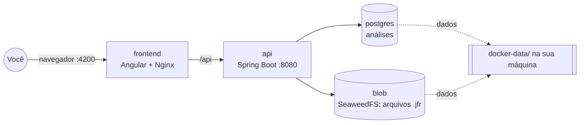

# JMC AI Analyzer — API

> Transforma gravações **JFR** (Java Flight Recorder) em um **diagnóstico em português**: o que está errado, onde está no seu código e o que fazer para arrumar.

Este repositório é o **back-end**. O front-end (telas) fica em [jmc-ai-analyzer-web](https://github.com/MaiconThales/jmc-ai-analyzer-web). Os dois sobem juntos com **um único comando**, a partir deste repositório (passo a passo abaixo).

---

## Sumário

- [O que é](#o-que-é)
- [O que faz](#o-que-faz)
- [Como funciona](#como-funciona)
- [Passo a passo para rodar](#passo-a-passo-para-rodar)
- [Usar no dia a dia](#usar-no-dia-a-dia)
- [Problemas comuns](#problemas-comuns)
- [API HTTP](#api-http)
- [Desenvolvimento](#desenvolvimento)
- [Estrutura do código](#estrutura-do-código)

---

## O que é

O **Java Mission Control (JMC)** lê gravações `.jfr` de aplicações Java e mostra centenas de números e regras, em inglês e espalhados por várias abas. É poderoso, mas difícil de interpretar.

O **JMC AI Analyzer** faz essa leitura por você: recebe um ou vários `.jfr`, usa a própria biblioteca do JMC para extrair as métricas e devolve uma **lista priorizada** (ALTA, MÉDIA, BAIXA) do que precisa ser arrumado, com:

- **o problema**, explicado em português;
- **a evidência** (os números que mostram o problema);
- **o local no seu código** (classe, método e linha), quando dá para identificar;
- **a ação recomendada**.

## O que faz

- **Upload de gravações**: envie de 1 a 20 arquivos `.jfr` por vez (até 128 MB cada), informando o software, a versão e o ambiente.
- **Diagnóstico priorizado**: regras próprias e as regras do JMC, traduzidas e ordenadas por prioridade, com uma **nota de saúde** de 0 a 100.
- **Métricas por domínio**: CPU, heap, GC, threads, *hot methods*, alocação, locks, exceções, I/O, suspeitos de vazamento e CPU por thread.
- **"Seu código" na pilha**: você informa os pacotes da sua aplicação (ex.: `com.empresa`) e o diagnóstico aponta a primeira linha do *seu* código em cada problema, também nas análises antigas.
- **Cobertura da gravação**: diz o que faltou gravar (ex.: exceções desligadas) e sugere o comando `-XX:StartFlightRecording` certo.
- **Lote consolidado**: com várias gravações, mostra cada problema "em N de M gravações" e um comparativo entre elas.
- **Histórico**: todas as análises ficam guardadas, com retenção configurável por software (padrão: 90 dias).
- **Nada se perde**: banco, arquivos e logs ficam numa pasta da sua máquina (`docker-data/`), não dentro dos containers.

## Como funciona



| Serviço | O que é | Porta na sua máquina |
|---|---|---|
| `frontend` | as telas (vem do repositório `jmc-ai-analyzer-web`) | **4200** |
| `api` | este projeto | **8080** |
| `postgres` | banco de dados das análises | não exposta |
| `blob` | armazenamento dos arquivos `.jfr` (compatível com S3) | não exposta |
| `data-init` | prepara as pastas de `docker-data/` e termina | — |

---

## Passo a passo para rodar

Você vai precisar só de **Git** e **Docker**. Não precisa instalar Java, Maven, Node nem PostgreSQL: tudo é compilado dentro do Docker.

### 1. Instale os pré-requisitos

| Ferramenta | Versão | Como conferir |
|---|---|---|
| Git | qualquer recente | `git --version` |
| Docker com Compose v2 | Docker Desktop (Windows/macOS) ou Docker Engine 24+ com o plugin `compose` (Linux) | `docker compose version` |

- **Memória**: deixe pelo menos **6 GB** para o Docker. No Docker Desktop: *Settings → Resources → Memory*. A API sozinha pode usar até 3 GB ao ler gravações grandes.
- **Portas livres**: `4200` e `8080`. Se estiverem em uso, veja [Problemas comuns](#problemas-comuns).
- **Windows**: use o Docker Desktop com WSL 2 e rode os comandos no PowerShell ou no terminal do WSL.

### 2. Baixe os dois projetos lado a lado

Os dois repositórios **precisam ficar na mesma pasta, com estes nomes exatos**, porque o Compose da API constrói o front a partir de `../jmc-ai-analyzer-web`:

```text
qualquer-pasta/
├── jmc-ai-analyzer-api/   ← este repositório (é daqui que você sobe tudo)
└── jmc-ai-analyzer-web/   ← o front-end
```

```bash
mkdir jmc-ai-analyzer
cd jmc-ai-analyzer
git clone -b refactore https://github.com/MaiconThales/jmc-ai-analyzer-api.git
git clone -b refactore https://github.com/MaiconThales/jmc-ai-analyzer-web.git
```

> [!IMPORTANT]
> A versão atual está na branch **`refactore`** dos dois repositórios. A `main` ainda tem uma versão antiga. Quando a `refactore` for mesclada na `main`, é só tirar o `-b refactore`.

> [!NOTE]
> **Baixou como ZIP pelo GitHub?** As pastas vêm com o nome da branch no final (ex.: `jmc-ai-analyzer-api-refactore`). Renomeie para `jmc-ai-analyzer-api` e `jmc-ai-analyzer-web`, ou ajuste `FRONTEND_CONTEXT` no `.env` (passo 3) para o nome da pasta do front.

### 3. Crie o arquivo de configuração `.env`

Entre na pasta da API e copie o modelo:

```bash
cd jmc-ai-analyzer-api
cp .env.example .env
```

No Windows (PowerShell): `Copy-Item .env.example .env`

Abra o `.env` num editor e troque os **três** valores `change-me`:

| Variável | O que colocar | Exemplo |
|---|---|---|
| `POSTGRES_PASSWORD` | uma senha para o banco | `senhaForte123` |
| `BLOB_ACCESS_KEY` | um "usuário" para o armazenamento de arquivos | `jmcapi` |
| `BLOB_SECRET_KEY` | uma "senha" para o armazenamento de arquivos | `segredoDoBlob_2026` |

> [!WARNING]
> Nas chaves do blob use **só letras, números, `-` e `_`** (sem espaço, aspas ou símbolos).

O resto pode ficar como está. Os mais comuns de mudar:

| Variável | Padrão | Para quê |
|---|---|---|
| `FRONTEND_PORT` / `API_PORT` | `4200` / `8080` | portas na sua máquina |
| `DATA_DIR` | `./docker-data` | onde ficam banco, arquivos e logs |
| `FRONTEND_CONTEXT` | `../jmc-ai-analyzer-web` | pasta do front-end |
| `APP_UID` / `APP_GID` | `1000` | **só no Linux**: coloque o resultado de `id -u` e `id -g` para os logs ficarem com o seu usuário |
| `API_MEMORY_LIMIT` | `3g` | memória máxima da API |

### 4. Suba tudo

Ainda dentro de `jmc-ai-analyzer-api`:

```bash
docker compose up -d --build
```

- A **primeira vez demora** (5 a 15 minutos): o Docker baixa as imagens e compila a API (Maven) e o front (npm). Nas próximas, é bem mais rápido.
- O `-d` deixa tudo rodando em segundo plano; o terminal fica livre.

### 5. Confira se subiu

```bash
docker compose ps
```

Espere até `postgres`, `blob`, `api` e `frontend` aparecerem como **`healthy`** (pode levar 1 ou 2 minutos depois do build). O `data-init` aparece como `exited (0)`: isso é normal, ele só prepara as pastas.

Depois abra no navegador:

| O quê | Endereço |
|---|---|
| **Aplicação (telas)** | http://localhost:4200 |
| Documentação da API (Swagger) | http://localhost:8080/swagger-ui.html |
| Saúde da API | http://localhost:8080/actuator/health |

### 6. Faça a primeira análise

1. Abra http://localhost:4200. A tela **Upload** já aparece.
2. Clique em **Escolher arquivos** e selecione os `.jfr` da pasta [`examples files/`](examples%20files/) deste repositório (ou arraste para a área pontilhada).
3. Em **Software**, digite um nome em minúsculas, como `meu-servico`. Versão, ambiente e descrição são opcionais.
4. Clique em **Enviar**. A tela de status acompanha o processamento sozinha.
5. Quando terminar, clique em **Ver dashboard do lote**: o topo mostra a nota de saúde e o bloco **O que arrumar** traz os problemas, do mais urgente ao menos urgente.
6. (Opcional) Em **Softwares**, clique em **editar** e informe os pacotes do seu código (ex.: `com.empresa`) para o diagnóstico apontar as linhas do *seu* código.

Pronto! 🎉

---

## Usar no dia a dia

Rode estes comandos dentro de `jmc-ai-analyzer-api`:

| Quero… | Comando |
|---|---|
| parar tudo (os dados ficam guardados) | `docker compose stop` |
| subir de novo | `docker compose up -d` |
| ver os logs da API ao vivo | `docker compose logs -f api` |
| atualizar depois de um `git pull` (nos dois repositórios) | `docker compose up -d --build` |
| remover os containers (os dados **continuam** em `docker-data/`) | `docker compose down` |
| **apagar tudo** e começar do zero | `docker compose down` e depois apague a pasta `docker-data/` |

> [!TIP]
> Os dados não ficam dentro dos containers: estão em `docker-data/` (banco em `postgres/`, arquivos em `seaweedfs/`, logs em `api/logs/` e `frontend/logs/`). Para fazer backup, pare tudo e copie essa pasta.

### Como gravar um bom `.jfr` na sua aplicação

```bash
java -XX:StartFlightRecording=settings=profile,duration=10m,filename=app.jfr,jdk.JavaExceptionThrow#enabled=true -jar sua-aplicacao.jar
```

Grave enquanto o problema acontece (ex.: no horário da lentidão). Se faltar algo, o bloco **Cobertura da gravação** do dashboard avisa e mostra o comando certo para copiar.

---

## Problemas comuns

| Sintoma | Causa provável | Como resolver |
|---|---|---|
| `required variable BLOB_ACCESS_KEY is missing` (ou `defina BLOB_ACCESS_KEY no .env`) | o `.env` não existe ou não está na pasta da API | volte ao [passo 3](#3-crie-o-arquivo-de-configuração-env) e rode os comandos **dentro** de `jmc-ai-analyzer-api` |
| `unable to prepare context: path "../jmc-ai-analyzer-web" not found` | o front não está ao lado da API ou a pasta tem outro nome | veja o [passo 2](#2-baixe-os-dois-projetos-lado-a-lado) ou ajuste `FRONTEND_CONTEXT` no `.env` |
| `port is already allocated` / `address already in use` | a porta 4200 ou 8080 já está em uso | troque `FRONTEND_PORT` ou `API_PORT` no `.env` e rode `docker compose up -d` |
| `dependency failed to start: container ... is unhealthy` | um serviço não ficou saudável a tempo | veja qual com `docker compose ps` e o motivo com `docker compose logs <serviço>`; depois rode `docker compose up -d` de novo |
| a API reinicia sozinha ou o lote falha com arquivo grande | pouca memória para o Docker | aumente a memória do Docker (mínimo 6 GB) ou reduza `APP_ANALYSIS_MAX_CONCURRENT` para `1` |
| `frontend` reiniciando sem parar, com `40-runtime-config.sh: not found` nos logs | o projeto foi baixado no Windows com quebra de linha CRLF e a versão do front é anterior à correção | atualize o `jmc-ai-analyzer-web` (`git pull`) e rode `docker compose up -d --build`; a imagem atual remove o CRLF sozinha. Opcional: `git config --global core.autocrlf input` antes de clonar |
| mudei a senha do banco no `.env` e a API não conecta | o banco já foi criado com a senha antiga | volte a senha antiga, ou apague `docker-data/postgres/` (**perde o histórico**) e suba de novo |
| a tela abre sem estilo ou desatualizada | cache do navegador com uma versão antiga | recarregue com `Ctrl+Shift+R` (`Cmd+Shift+R` no macOS) |

Ainda travou? Rode `docker compose ps` e `docker compose logs --tail=100 <serviço>` e guarde a saída: ela mostra exatamente onde parou.

---

## API HTTP

Tudo o que as telas fazem também pode ser feito direto pela API (documentação interativa em http://localhost:8080/swagger-ui.html).

```bash
curl -F software=billing-service -F environment=PROD -F "description=lentidão às 14h" \
     -F files=@app-1.jfr -F files=@app-2.jfr http://localhost:8080/api/v1/analyses
```

| Método | Caminho | Descrição |
|---|---|---|
| `POST` | `/api/v1/analyses` | upload de 1..N `.jfr` (`202 Accepted`) |
| `GET` | `/api/v1/analyses?software=` | histórico paginado |
| `GET` | `/api/v1/analyses/{batchId}` | status do lote |
| `GET` | `/api/v1/analyses/{batchId}/dashboard?topN=10` | dashboard consolidado do lote |
| `GET` | `/api/v1/recordings/{recordingId}/dashboard?topN=10` | dashboard de uma gravação |
| `GET` / `PATCH` | `/api/v1/software` · `/api/v1/software/{name}` | retenção e pacotes da aplicação |
| `GET` | `/api/v1/config` | limites de upload, top-N e retenção (usado pelo front) |

Para apontar o seu código nas pilhas: `PATCH /api/v1/software/{name}` com `{"appPackages":["com.empresa"]}`.

---

## Desenvolvimento

Para mexer no código da API fora do Docker.

**Requisitos**: JDK 17+, Maven 3.9+ (ou o `./mvnw` do projeto) e Docker (os testes usam Testcontainers com PostgreSQL e SeaweedFS).

```bash
./mvnw clean verify      # compila, testa e confere a cobertura (falha abaixo de 90%)
```

Para rodar a API pela IDE usando o banco e o blob do Docker, suba só eles expostos em `127.0.0.1`:

```bash
docker compose -f docker-compose.yml -f docker-compose.debug.yml up -d postgres blob
```

Análise no SonarQube (sem CI na v0.1.0):

```bash
./mvnw clean verify sonar:sonar -Dsonar.host.url=$SONAR_HOST_URL -Dsonar.token=$SONAR_TOKEN
```

**Stack**: Java 17 · Spring Boot 4.1.2 · PostgreSQL 17 · Flyway · JMC core 9.1.2 · SeaweedFS (S3, AWS SDK v2) · Docker Compose.

**Documentação**:

- especificação, plano e tarefas: [`.spec/0.1.0/`](.spec/0.1.0/);
- documentação de produto (Obsidian): [`jmc-ai-analyzer-api/v0.1.0/`](jmc-ai-analyzer-api/v0.1.0/).

### Teste de persistência

1. Envie um `.jfr` e espere o lote ficar `COMPLETED`.
2. Rode `docker compose down -v` e depois `docker compose up -d`.
3. O histórico e o dashboard continuam lá (os dados estão em `docker-data/`, não em volumes do Docker).

## Estrutura do código

```text
io.github.maiconthales.jmc_ai_analyzer_api
├── system
│   ├── config · properties          configuração Spring e @ConfigurationProperties
│   ├── controllers · dto · mapper   API HTTP, DTOs/records e conversões
│   ├── services                     somente *Service
│   ├── components                   @Component (validação, fila, retenção, extração, regras de diagnóstico)
│   ├── exceptions · handlers        exceções de negócio e ProblemDetail
│   ├── utils                        utilitários estáticos (leitura de eventos JFR, extratores)
│   └── entity · enums · repository  persistência
├── mcp      WIP
└── ia       WIP
```

Regras de organização: [`.spec/0.1.0/plan.md`](.spec/0.1.0/plan.md) §2.
