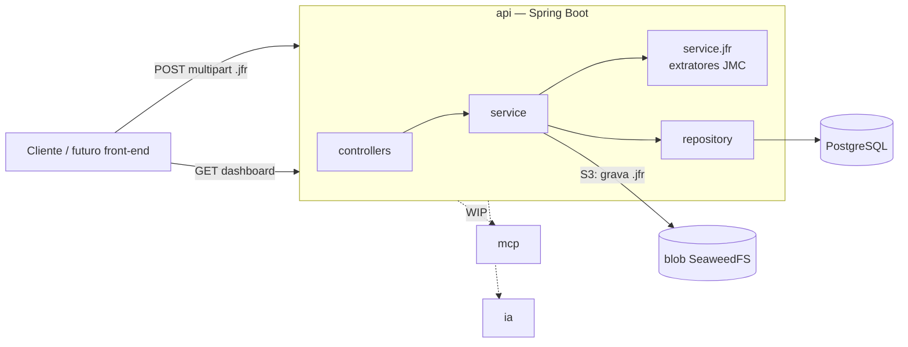

# JMC AI Analyzer API — v0.1.0

> [!abstract] Em uma frase
> API Spring Boot que recebe um ou vários arquivos `.jfr`, extrai deles tudo o que ajuda a diagnosticar problemas no software, guarda o histórico no PostgreSQL e entrega os dados prontos para um dashboard.

> [!info] Como usar esta documentação
> Esta pasta é a **fonte de verdade** antes do SDD. Quando todas as notas estiverem com `status: aprovado`, geramos `.spec/0.1.0/spec.md`, `plan.md` e `tasks.md` a partir delas.
> A origem é a nota [[Arquivo bruto]].

> [!success] SDD gerado em 2026-11-17
> `.spec/0.1.0/spec.md`, `plan.md` e `tasks.md`, na raiz do repositório. Mudanças futuras devem ser feitas aqui e no SDD.

## Mapa

| # | Nota | Vira no SDD |
|---|---|---|
| 01 | [[01 Visão geral e escopo]] | `spec.md` |
| 02 | [[02 Arquitetura]] | `plan.md` |
| 03 | [[03 Requisitos]] | `spec.md` |
| 04 | [[04 Extração JFR]] | `spec.md` + `plan.md` |
| 05 | [[05 Modelo de dados]] | `plan.md` |
| 06 | [[06 API]] | `spec.md` + `plan.md` |
| 07 | [[07 Infraestrutura e qualidade]] | `plan.md` + `tasks.md` |
| 08 | [[08 Decisões e questões]] | todas |
| 09 | [[09 Armazenamento blob]] | `plan.md` + `tasks.md` |
| 10 | [[10 Propostas de diagnóstico]] | `spec.md` + `plan.md` |

## Fluxo geral

## Status das notas

- [x] [[01 Visão geral e escopo]] revisada
- [x] [[02 Arquitetura]] revisada
- [x] [[03 Requisitos]] revisada
- [x] [[04 Extração JFR]] revisada
- [x] [[05 Modelo de dados]] revisada
- [x] [[06 API]] revisada
- [x] [[07 Infraestrutura e qualidade]] revisada
- [x] [[09 Armazenamento blob]] revisada
- [x] [[08 Decisões e questões#Questões respondidas|Questões]] respondidas
- [ ] [[08 Decisões e questões#Pendências|Pendências]] resolvidas (falta medir os limites de upload)
- [x] [[10 Propostas de diagnóstico]] decidida
