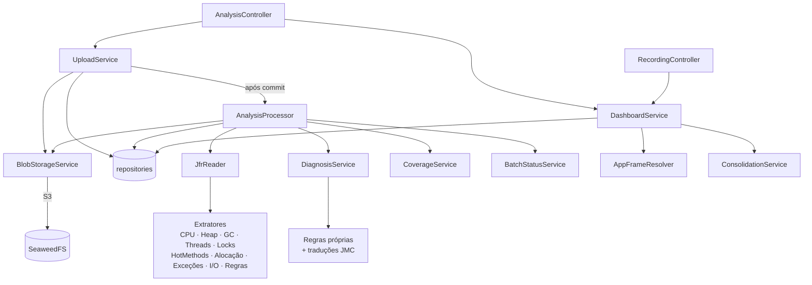
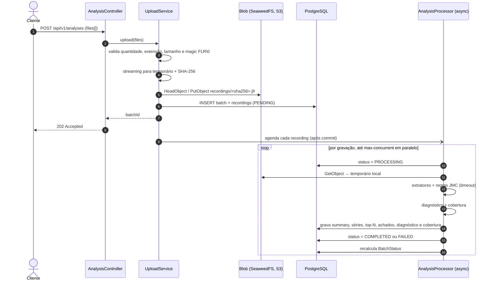

# Arquitetura

Voltar: [[00 Índice]]

## Stack

| Item | Escolha | Observação |
|---|---|---|
| Linguagem | Java 17 | |
| Framework | Spring Boot **4.1.2** | Spring Framework 7, Hibernate 7.4, **Jackson 3** (`tools.jackson.*`) |
| Banco | PostgreSQL | driver 42.7.x, gerenciado pelo Boot |
| Migrações | Flyway 12 | precisa de `flyway-database-postgresql` |
| Leitura JFR | `org.openjdk.jmc:flightrecorder` + `flightrecorder.rules.jdk` **9.1.2** | bytecode Java 17, conferido no Maven Central |
| Boilerplate | Lombok 1.18.48 | gerenciado pelo Boot |
| Blob storage | SeaweedFS (API S3) + AWS SDK for Java v2 | ver [[09 Armazenamento blob]] |
| Container | Docker + Compose, com dados mapeados no host | ver [[07 Infraestrutura e qualidade#Persistência no host]] |
| Testes | JUnit 5, Mockito, Testcontainers 2.0.5 | ver [[07 Infraestrutura e qualidade#Testes]] |

### Starters do Spring Boot 4.1.2

> [!warning] O Boot 4 reorganizou os starters
> Os nomes abaixo foram conferidos no Maven Central para a versão 4.1.2. Não use os nomes do Boot 3 de memória.

| Uso | Artefato |
|---|---|
| REST | `spring-boot-starter-webmvc` |
| JPA | `spring-boot-starter-data-jpa` |
| Validação | `spring-boot-starter-validation` |
| Flyway | `spring-boot-starter-flyway` + `org.flywaydb:flyway-database-postgresql` |
| Health | `spring-boot-starter-actuator` |
| Swagger (fora do Boot) | `org.springdoc:springdoc-openapi-starter-webmvc-ui` 3.x |
| Testes web | `spring-boot-starter-webmvc-test` |
| Testes JPA | `spring-boot-starter-data-jpa-test` |
| Testes Flyway | `spring-boot-starter-flyway-test` |
| Testcontainers | `spring-boot-testcontainers` + `org.testcontainers:testcontainers-postgresql` (+ `GenericContainer` do SeaweedFS) |
| S3 (fora do Boot) | `software.amazon.awssdk:s3`, versão pelo `software.amazon.awssdk:bom` |

## Estrutura de pacotes

Definida em [[Arquivo bruto]]. Os subpacotes só existem quando forem necessários.

```text
io.github.maiconthales.jmc_ai_analyzer_api
├── JmcAiAnalyzerApiApplication.java
├── system
│   ├── config        → BlobProperties, StorageProperties, UploadProperties, AnalysisProperties, RetentionProperties, AsyncConfig, BlobStorageConfig, OpenApiConfig
│   ├── controllers   → AnalysisController, RecordingController, SoftwareController
│   │   └── dto       → records de request/response
│   ├── handlers      → ApiExceptionHandler (@RestControllerAdvice) + exceções de negócio
│   ├── enums         → AnalysisStatus, BatchStatus, MetricType, LockType, IoType, FindingSeverity, ErrorCode
│   ├── entity        → entidades JPA (ver [[05 Modelo de dados]])
│   ├── service
│   │   ├── UploadService, BlobStorageService, AnalysisProcessor,
│   │   │   DiagnosisService, CoverageService, AppFrameResolver,
│   │   │   DashboardService, ConsolidationService, BatchStatusService,
│   │   │   SoftwareService, RetentionJob
│   │   ├── jfr       → JfrReader + um extrator por domínio (ver [[04 Extração JFR]])
│   │   └── diagnosis → DiagnosisRule (interface) + uma classe por regra do catálogo e traduções dos achados do JMC (ver [[10 Propostas de diagnóstico]])
│   └── repository    → Spring Data JPA
├── mcp               → WIP: só package-info.java
└── ia                → WIP: só package-info.java
```

> [!note] DTOs dentro de `controllers.dto`
> O [[Arquivo bruto]] não lista um subpacote `dto`. Para não criar uma camada nova, os DTOs HTTP ficam em `controllers.dto` como `record`s. Ver [[08 Decisões e questões#D-05 — DTOs em controllers.dto]].

## Componentes do `system`



| Componente             | Responsabilidade                                                                                                                                              |
| ---------------------- | ------------------------------------------------------------------------------------------------------------------------------------------------------------- |
| `UploadService`        | Valida o lote, faz streaming para um temporário calculando o SHA-256, envia ao blob via `BlobStorageService`, cria `analysis_batch` e `jfr_recording` e agenda o processamento **depois do commit** da transação. |
| `BlobStorageService`   | Fala com o SeaweedFS pela API S3: garante o bucket, deduplica por `HeadObject`, envia e baixa `recordings/<sha256>.jfr`. Ver [[09 Armazenamento blob]].      |
| `AnalysisProcessor`    | Roda no executor limitado: marca `PROCESSING`, chama o `JfrReader`, persiste os resultados numa transação e marca `COMPLETED` ou `FAILED`.                    |
| `JfrReader`            | Carrega a gravação com `JfrLoaderToolkit` e repassa os `IItemCollection` aos extratores.                                                                      |
| Extratores             | Um por domínio. Cada um é uma função pura `IItemCollection → resultado`, fácil de testar.                                                                     |
| `BatchStatusService`   | Recalcula o `BatchStatus` (ver [[03 Requisitos#RF-03 — Processamento assíncrono]]).                                                                           |
| `DashboardService`     | Monta a resposta por gravação.                                                                                                                                |
| `ConsolidationService` | Agrega as gravações de um lote (ver [[04 Extração JFR#Consolidação do lote]]).                                                                                |
| `DiagnosisService`     | Roda o catálogo de regras próprias, traduz os achados do JMC e gera `diagnosis_item` e `health_score` ([[03 Requisitos#RF-13 — Diagnóstico com prioridade]]).        |
| `CoverageService`      | Monta a cobertura da gravação e o comando sugerido ([[03 Requisitos#RF-14 — Cobertura da gravação]]).                                                     |
| `AppFrameResolver`     | Na consulta, escolhe o `appFrame` a partir de `stack_frames` e dos `appPackages` do software ([[03 Requisitos#RF-15 — Localizar no código]]).              |
| `SoftwareService`      | Busca ou cria o software do upload e altera a retenção.                                                                                                      |
| `RetentionJob`         | `@Scheduled` diário: apaga lotes vencidos por software e objetos do blob sem referência (ver [[03 Requisitos#RF-11 — Software e retenção]]).                  |

## Fluxo do upload



> [!tip] Retomada depois de reinício
> Um `ApplicationRunner` busca as gravações em `PENDING` ou `PROCESSING` e as coloca de volta na fila. Ver [[03 Requisitos#RF-03 — Processamento assíncrono]].

## Pacotes WIP

> [!todo] `mcp` e `ia`
> Na v0.1.0 cada um tem só um `package-info.java` com Javadoc explicando o papel futuro:
> - `mcp`: expor as análises persistidas como tools MCP;
> - `ia`: interpretar os agregados (nunca o `.jfr` bruto) e gerar resumo e recomendações.
>
> Nenhuma task de implementação entra no SDD da v0.1.0.
