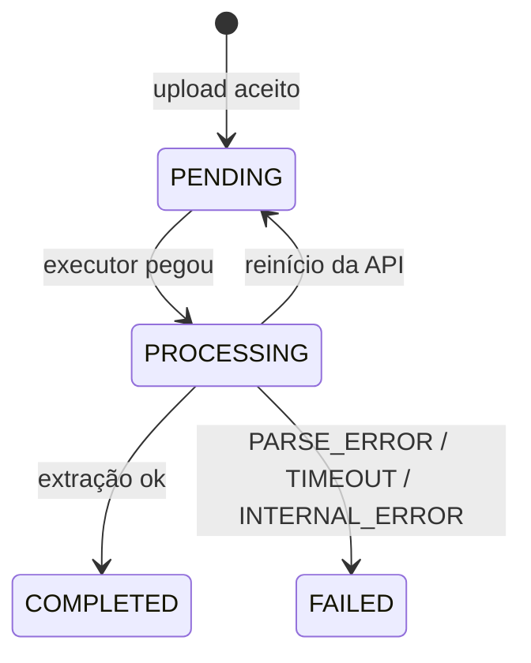

# Requisitos

Voltar: [[00 Índice]]

## Requisitos funcionais

### RF-01 — Upload de arquivos JFR

`POST /api/v1/analyses` recebe `multipart/form-data` com os campos abaixo. Detalhes do contrato em [[06 API#POST /api/v1/analyses]].

| Campo | Obrigatório | Regra |
|---|---|---|
| `files` | sim (1..N) | arquivos `.jfr` |
| `software` | **sim** | identificador do software, em *slug* `^[a-z0-9][a-z0-9-]{1,63}$` (por exemplo `billing-service`). Se ainda não existir, é criado com a retenção padrão. Ver [[#RF-11 — Software e retenção]]. |
| `environment` | não | `PROD`, `HML`, `DEV` ou `LOCAL` ([[10 Propostas de diagnóstico#P-07 — Contexto do upload\|P-07]]) |
| `description` | não | até 500 caracteres, por exemplo "lentidão no fechamento às 14h" ([[10 Propostas de diagnóstico#P-07 — Contexto do upload\|P-07]]) |
| `softwareVersion` | não | texto livre, até 64 caracteres. Se não vier, a API tenta extrair do nome do jar em `javaArgs` (por exemplo `app-1.4.2.jar` → `1.4.2`); se não achar, fica nulo. |

Validações, todas feitas **antes** de aceitar o lote:

- [ ] `software` presente e válido → senão `INVALID_PARAMETER`;
- [ ] pelo menos 1 arquivo → senão `EMPTY_UPLOAD`;
- [ ] no máximo `app.upload.max-files` (padrão **20**) → senão `TOO_MANY_FILES`;
- [ ] extensão `.jfr` → senão `INVALID_FILE`;
- [ ] os 4 primeiros bytes são `FLR\0` → senão `INVALID_FILE`;
- [ ] tamanho por arquivo ≤ `app.upload.max-file-size` (padrão **128 MB**) → senão `FILE_TOO_LARGE`;
- [ ] tamanho da requisição ≤ `app.upload.max-request-size` (padrão **1 GB**) → senão `FILE_TOO_LARGE`.

> [!info] Por que esses limites (resposta da Q2)
> Os exemplos reais têm ~1,5 MB por minuto de gravação. **128 MB** cobre cerca de 1h30 de gravação contínua por arquivo. Com o parser usando ~20× o tamanho do arquivo em heap, isso dá ~2,5 GB por arquivo; com `max-concurrent = 2`, a API precisa de **~6 GB** de memória. Os valores ficam a validar com um arquivo grande. Ver [[08 Decisões e questões#D-11 — Limites de upload]].

> [!warning] Tudo ou nada
> Se qualquer validação falhar, nada é persistido. Objetos que já tinham sido enviados ao blob durante a requisição são apagados, a menos que o mesmo SHA-256 já existisse antes. Se o blob estiver fora do ar, a resposta é `503 STORAGE_UNAVAILABLE`.

### RF-02 — Armazenamento do arquivo original

- O arquivo é enviado ao **blob storage** (SeaweedFS, API S3), no bucket `${app.blob.bucket}`, com a chave `recordings/<sha256>.jfr`. Detalhes em [[09 Armazenamento blob]].
- O mesmo SHA-256 reaproveita o mesmo objeto (`HeadObject` antes de enviar).
- O banco guarda nome original (sanitizado), tamanho, SHA-256, bucket e chave do objeto.
- O cliente nunca informa nem recebe caminhos, buckets ou chaves.

### RF-03 — Processamento assíncrono

- Cada gravação é processada de forma independente, num executor limitado (`app.analysis.max-concurrent`, padrão **2**).
- Cada gravação tem timeout de processamento (`app.analysis.timeout`, padrão **10 min**) → senão `TIMEOUT`.
- A falha de uma gravação não interrompe as outras.
- Na inicialização, gravações em `PENDING` ou `PROCESSING` voltam para a fila.

Estados de uma gravação (`AnalysisStatus`):

Estado do lote (`BatchStatus`), **derivado** das gravações:

| Situação das gravações | Lote |
|---|---|
| alguma `PENDING` ou `PROCESSING` | `PROCESSING` |
| todas `COMPLETED` | `COMPLETED` |
| ≥1 `COMPLETED` e ≥1 `FAILED` | `PARTIAL` |
| todas `FAILED` | `FAILED` |

### RF-04 — Extração de dados do JFR

Extrair metadados, CPU, heap, GC, threads, locks, hot methods, alocação, exceções, I/O, **suspeitos de vazamento**, **CPU por thread** e achados das regras do JMC. Os itens de top-N guardam a pilha e o frame da aplicação ([[#RF-15 — Localizar no código]]).

Eventos, cálculos e limites estão em [[04 Extração JFR]].

### RF-05 — Dashboard por gravação

`GET /api/v1/recordings/{recordingId}/dashboard?topN=10` devolve todos os domínios de uma gravação.

- Se a gravação não estiver `COMPLETED`: `409 NOT_READY`, com o status atual.
- Se estiver `FAILED`: `409 NOT_READY`, com `errorCode` e `errorMessage`.

### RF-06 — Dashboard consolidado do lote

`GET /api/v1/analyses/{batchId}/dashboard?topN=10` agrega só as gravações `COMPLETED`. As regras estão em [[04 Extração JFR#Consolidação do lote]].

Se nenhuma gravação estiver `COMPLETED`, a resposta é `409 NOT_READY`.

### RF-07 — Status do lote

`GET /api/v1/analyses/{batchId}` devolve o estado do lote e a lista de gravações (nome, tamanho, status, erro, início e fim do processamento).

### RF-08 — Histórico

`GET /api/v1/analyses?software=billing-service&page=0&size=20&sort=createdAt,desc` devolve a lista paginada de lotes com software, versão, data, quantidade de arquivos, status e quantidade de achados `WARNING`. O filtro `software` é opcional.

### RF-09 — Health check

`GET /actuator/health` mostra a saúde da aplicação, do banco (`db`) e do blob storage (`blobStorage`: `HeadBucket` responde).

### RF-10 — Erros padronizados

Respostas de erro em `application/problem+json` (RFC 9457), via `ProblemDetail`. A lista de códigos está em [[06 API#Erros]].

### RF-11 — Software e retenção

- Todo lote pertence a um **software** (informado no upload). A **versão** é só um atributo do lote e pode mudar a cada envio.
- Cada software tem `retentionDays` (padrão `app.retention.default-days` = **90**), que pode ser alterado por software via API ([[06 API#Software]]).
- Um job diário (`app.retention.cron`, padrão `0 0 3 * * *`) apaga os lotes com `created_at` anterior a `agora - retentionDays` do seu software, com todas as tabelas filhas.
- Depois, apaga do blob os objetos cujo `sha256` não é mais referenciado por nenhuma gravação.
- O job registra no log quantos lotes, gravações e objetos foram removidos por software.
- Lotes em `PROCESSING` nunca são apagados.

### RF-13 — Diagnóstico com prioridade

Cada gravação processada gera uma lista de **itens de diagnóstico**. Ela junta os achados do JMC (`INFO`/`WARNING`) e as **regras próprias** do catálogo em português. Cada item tem prioridade, categoria, título, evidência, localização, ação e origem. Também é calculada uma **nota de saúde** de 0 a 100.

- Formato, prioridade e nota: [[10 Propostas de diagnóstico#P-01 — Diagnóstico unificado com prioridade]].
- Catálogo e limites (`app.diagnosis.*`): [[10 Propostas de diagnóstico#P-02 — Catálogo de regras próprias em português]].
- Os achados do JMC com tradução no catálogo mostram título e ação em português; os demais, o texto original.
- O diagnóstico é persistido no processamento (tabela `diagnosis_item`) e aparece no **topo** dos dois dashboards. No consolidado, itens com a mesma origem e localização são unidos, ficando com a maior prioridade e a lista de gravações afetadas.

### RF-14 — Cobertura da gravação

Cada gravação informa o que **não pode ser diagnosticado** com ela e como gravar melhor: domínio, situação (`OK`, `AUSENTE`, `INSUFICIENTE`), motivo e recomendação. O bloco termina com um comando `-XX:StartFlightRecording` sugerido. Uma cobertura ruim gera também um item de diagnóstico `GRAVACAO` de prioridade `BAIXA`.

Detalhes: [[10 Propostas de diagnóstico#P-03 — Cobertura da gravação]].

### RF-15 — Localizar no código

- Cada item de top-N (hot method, alocação, exceção, lock, suspeito de vazamento) guarda os **5 frames de topo**, com classe, método e linha.
- Cada software tem `appPackages` (prefixos de pacote, alterados no `PATCH /api/v1/software/{name}`).
- A API marca o **primeiro frame que pertence a esses pacotes** como `appFrame`. Se `appPackages` estiver vazio, o `appFrame` é o primeiro frame que não seja de `java.`, `javax.`, `jdk.`, `sun.`, `com.sun.`, `org.springframework.`, `org.apache.` ou `io.netty.` (lista configurável).
- O `appFrame` é calculado **na consulta**, a partir de `stack_frames`. Assim, mudar `appPackages` vale também para análises antigas.

Detalhes: [[10 Propostas de diagnóstico#P-04 — Localizar no código]].

### RF-12 — Documentação da API (Swagger)

- `springdoc-openapi-starter-webmvc-ui` (linha 3.x, compatível com o Spring Boot 4; versão exata conferida no bootstrap).
- Swagger UI em `/swagger-ui.html` e o contrato em `/v3/api-docs`.
- Todos os endpoints com `@Operation`, exemplos de resposta e os erros `problem+json`.

## Requisitos não funcionais

> [!check] RNF-01 — Sonar
> Seguir as regras padrão do SonarQube (*Sonar way*). Nenhuma issue *Blocker*, *Critical* ou *Major*, e duplicação ≤ 3%. Ver [[07 Infraestrutura e qualidade#Sonar]].

> [!check] RNF-02 — Cobertura de 90%
> Mínimo de 90% de **linhas** e 90% de **branches** no JaCoCo. O `mvn verify` falha se não atingir. Ver [[07 Infraestrutura e qualidade#JaCoCo]].

> [!check] RNF-03 — Lombok
> - Usar `@Getter`, `@Setter`, `@NoArgsConstructor(access = PROTECTED)`, `@RequiredArgsConstructor`, `@Builder` e `@Slf4j`.
> - **Não** usar `@Data`, `@ToString` sem `exclude` nem `@EqualsAndHashCode` padrão em entidades JPA. `equals`/`hashCode` são feitos pelo id.
> - DTOs são `record`s, sem Lombok.

- **RNF-04 — Memória**: o upload vai direto para disco (streaming). O `.jfr` nunca é carregado inteiro a partir do multipart.
- **RNF-05 — Segurança**: nenhum caminho vem do cliente; o nome original é sanitizado; credenciais vêm de variáveis de ambiente; o PostgreSQL só é acessível pela rede interna do Compose.
- **RNF-06 — Configuração**: limites, diretórios, timeouts e banco são configuráveis por `application.yml` e variáveis de ambiente (prefixo `app.*`, via `@ConfigurationProperties` validadas).
- **RNF-07 — Docker**: `docker compose up` sobe banco, blob e API prontos, com health checks.
- **RNF-08 — Observabilidade**: logs com `software`, `batchId` e `recordingId` no MDC e a duração de cada processamento.
- **RNF-09 — Persistência no host**: todo dado de container é *bind mount* para `${DATA_DIR}` na máquina real. Nenhum *named volume*, nenhum estado na camada do container. Ver [[07 Infraestrutura e qualidade#Persistência no host]].
- **RNF-10 — Dados sensíveis da gravação**: o `.jfr` contém variáveis de ambiente (`jdk.InitialEnvironmentVariable`), propriedades de sistema e a lista de processos da máquina (`jdk.SystemProcess`). A API **não persiste nem expõe** esses dados no banco ou no dashboard; eles ficam só no `.jfr` guardado no blob.

## Critérios de aceite

1. Upload de 1 arquivo válido → `202`, e a gravação chega a `COMPLETED` com os domínios disponíveis preenchidos.
2. Upload de 3 arquivos, sendo 1 corrompido → lote `PARTIAL`, 2 `COMPLETED` e 1 `FAILED` com `PARSE_ERROR`.
3. Extensão errada, magic number inválido, arquivos demais ou tamanho excedido → rejeitado sem persistir nada.
4. O dashboard por gravação traz metadados, CPU, heap, GC, threads, locks, hot methods, alocação, exceções, I/O e achados.
5. O consolidado mescla os top-N, soma os totais e lista as séries por gravação.
6. Histórico e arquivos `.jfr` sobrevivem a `docker compose down -v` + `up`, porque os dados estão em `${DATA_DIR}` no host.
7. Gravações pendentes são retomadas depois de reiniciar a API.
8. `mvn verify` passa com cobertura ≥ 90%, e `mvn sonar:sonar` no SonarQube passa no *Quality Gate*, sem issues *Blocker*, *Critical* ou *Major*.
10. Upload sem `software` é rejeitado; com `software` novo, ele é criado com a retenção padrão.
11. O job de retenção apaga só os lotes vencidos do software certo e remove do blob apenas objetos sem referência.
12. O Swagger UI lista todos os endpoints com exemplos.
13. Os 3 arquivos de `examples files/` processam até `COMPLETED` nos testes de integração.
14. Para os arquivos de exemplo, o diagnóstico contém pelo menos `TIERED_STOP_LEVEL`, `ACTIVE_PROCESSOR_COUNT` e o achado de alocação do JMC, e a cobertura marca exceções e I/O de arquivo como `AUSENTE`.
15. Com `appPackages` definido, o `appFrame` aponta para o primeiro frame desse pacote; ao mudar `appPackages`, as análises antigas refletem a mudança.
16. `environment` e `description` aparecem no status do lote e no histórico.
9. `ia` e `mcp` existem só com `package-info.java` marcado como WIP.
