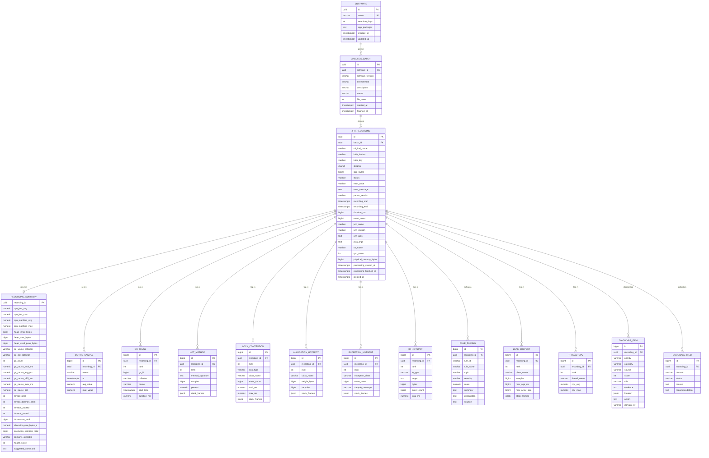

# Modelo de dados

Voltar: [[00 Índice]] · Origem dos dados: [[04 Extração JFR]]

> [!info] Granularidade
> **Agregados + séries reduzidas + top-N.** Não há eventos brutos, e o `.jfr` original fica no blob storage. Ver [[08 Decisões e questões#D-02 — Granularidade da persistência]] e [[08 Decisões e questões#D-03 — Arquivo .jfr em blob storage (SeaweedFS)]].

## Diagrama

## Regras do modelo

- **Chaves**: `uuid` para `software`, `analysis_batch` e `jfr_recording`, que aparecem na API; `bigint identity` para as tabelas filhas.
- **`software.name`**: único, no formato *slug*. `retention_days` tem `CHECK (retention_days > 0)`.
- **FKs**: todas as tabelas filhas usam `ON DELETE CASCADE` a partir de `jfr_recording`, e `jfr_recording` a partir de `analysis_batch`. É isso que o job de retenção usa ([[03 Requisitos#RF-11 — Software e retenção]]). `analysis_batch.software_id` usa `ON DELETE RESTRICT`: um software não é apagado na v0.1.0.
- **Enums**: gravados como `varchar` com `@Enumerated(EnumType.STRING)` e `CHECK` no banco:
  - `AnalysisStatus`: `PENDING`, `PROCESSING`, `COMPLETED`, `FAILED`
  - `BatchStatus`: `PROCESSING`, `COMPLETED`, `PARTIAL`, `FAILED`
  - `MetricType`: `CPU_JVM_USER`, `CPU_JVM_SYSTEM`, `CPU_MACHINE`, `HEAP_USED`, `HEAP_COMMITTED`, `THREADS_ACTIVE`, `THREADS_DAEMON`
  - `LockType`: `MONITOR_ENTER`, `MONITOR_WAIT`, `THREAD_PARK`
  - `IoType`: `FILE_READ`, `FILE_WRITE`, `SOCKET_READ`, `SOCKET_WRITE`
  - `Priority`: `ALTA`, `MEDIA`, `BAIXA`
  - `DiagnosisCategory`: `MEMORIA`, `GC`, `CPU`, `THREADS`, `LOCKS`, `EXCECOES`, `IO`, `CONFIG_JVM`, `AMBIENTE`, `GRAVACAO`
  - `CoverageStatus`: `OK`, `AUSENTE`, `INSUFICIENTE`
  - `Environment`: `PROD`, `HML`, `DEV`, `LOCAL`
  - `FindingSeverity`: `OK`, `INFO`, `WARNING` (as mesmas do JMC; `NA` e `IGNORE` não são persistidas)
  - `ErrorCode`: ver [[06 API#Erros]]
- **`stack_frames`**: `jsonb` com até 5 frames `{c, m, d, l}` (classe, método, descritor, linha). Não há coluna `app_frame`: ele é calculado na consulta ([[03 Requisitos#RF-15 — Localizar no código]]).
- **`app_packages`**: prefixos separados por vírgula, por exemplo `com.empresa,br.com.cliente`.
- **`health_score`**: de 0 a 100, calculado no processamento ([[10 Propostas de diagnóstico#P-01 — Diagnóstico unificado com prioridade]]).
- **`domains_available`**: lista dos domínios que tinham eventos, separada por vírgula (por exemplo `CPU,HEAP,GC`).
- **Índices**:
  - `jfr_recording(batch_id)` e `jfr_recording(status)`;
  - `jfr_recording(sha256)`, que não é único porque o mesmo arquivo pode estar em vários lotes;
  - `metric_sample(recording_id, metric, ts)`;
  - `(recording_id, rank)` em cada tabela de top-N;
  - `rule_finding(recording_id, severity)`;
  - `diagnosis_item(recording_id, priority)`;
  - `analysis_batch(software_id, created_at desc)` para o histórico filtrado e para o job de retenção;
  - `analysis_batch(created_at desc)` para o histórico geral.
- **Migrações Flyway**: `V1__create_software_batch_and_recording.sql`, `V2__create_summary_and_series.sql`, `V3__create_hotspots.sql`, `V4__create_rule_finding.sql`, `V5__create_leak_and_thread_cpu.sql`, `V6__create_diagnosis_and_coverage.sql`.
- **Gravação atômica**: summary, séries, top-N, achados e `status = COMPLETED` são gravados numa **única transação**. Se ela falhar, a gravação fica `FAILED` e nada parcial permanece.
- **Inserções em lote**: `hibernate.jdbc.batch_size=500` e `order_inserts=true`. Isso exige sequência com `allocationSize` compatível, não `IDENTITY` puro, para as tabelas filhas.

> [!question] Ajuste possível
> Se preferir não usar sequência nas tabelas filhas, dá para inserir séries e top-N com `JdbcClient` em lote e manter `IDENTITY`. Fica como decisão no SDD.
