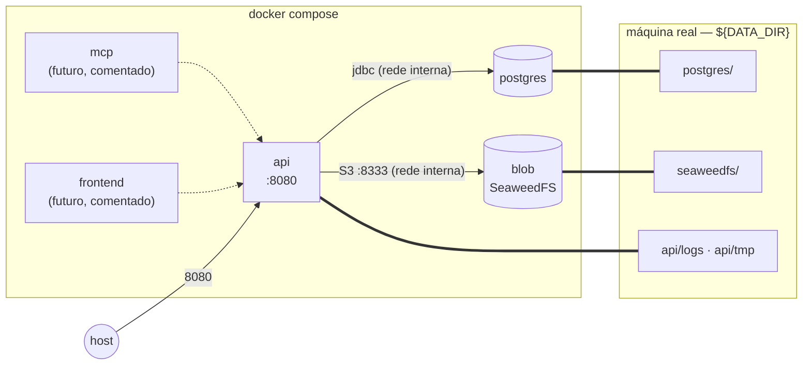

# Infraestrutura e qualidade

Voltar: [[00 Índice]]

## Docker

### Imagem da API — `Dockerfile` em multi-stage

1. **build**: `maven:3.9-eclipse-temurin-17`, com `mvn -B -DskipTests package` e cache das dependências em uma camada separada (`dependency:go-offline`).
2. **runtime**: `eclipse-temurin:17-jre`, com usuário não-root, `HEALTHCHECK` em `/actuator/health` e `JAVA_OPTS` configurável.

### `docker-compose.yml`



| Serviço | Imagem | Portas | Mapeamento no host (bind mount) | Health |
|---|---|---|---|---|
| `postgres` | `postgres:17-alpine` | **não exposta** | `${DATA_DIR}/postgres:/var/lib/postgresql/data` | `pg_isready` |
| `data-init` | `alpine:3.22` (roda e termina) | — | `${DATA_DIR}:/data` | cria as pastas e ajusta os donos antes dos outros serviços |
| `blob` | `chrislusf/seaweedfs:4.52` | **não exposta** (8333 interna) | `${DATA_DIR}/seaweedfs:/data` | `GET :8333/healthz` |
| `api` | build local | `8080:8080` | `${DATA_DIR}/api/logs:/app/logs` e `${DATA_DIR}/api/tmp:/app/tmp` | `/actuator/health` |
| `mcp` | — | — | `${DATA_DIR}/mcp/...` quando existir | bloco comentado (WIP) |
| `frontend` | build de `../jmc-ai-analyzer-web` (Nginx) | `4200:8080` | `${DATA_DIR}/frontend/logs:/var/log/nginx` | `/healthz` |

- `api` usa `depends_on` com `condition: service_healthy` para `postgres` e `blob`.
- `.env.example` versionado; `.env` fica no `.gitignore`.
- Detalhes do blob em [[09 Armazenamento blob]].

### Persistência no host

> [!important] Regra: todo dado do Docker fica numa pasta da máquina real
> Nenhum serviço usa *named volume* nem guarda estado na camada do container. Todo diretório com dado é um **bind mount** para `${DATA_DIR}` (padrão `./docker-data`, na raiz do repositório). Assim, reiniciar, recriar (`docker compose down` + `up`) ou atualizar a imagem não apaga nada, nem mesmo `docker compose down -v`.

```text
${DATA_DIR}/                 # padrão ./docker-data (no .gitignore)
├── postgres/                # dados do PostgreSQL
├── seaweedfs/               # objetos do blob (.jfr originais)
├── api/
│   ├── logs/                # logs em arquivo da API (rotação diária, 14 dias)
│   └── tmp/                 # temporários de upload/processamento (limpos automaticamente)
├── mcp/                     # reservado (WIP)
└── frontend/                # reservado (WIP)
```

- **Criação das pastas**: o serviço `data-init` cria a árvore a cada `up` e ajusta os donos (API com `APP_UID`/`APP_GID`, logs do Nginx com o UID 101). Não há script para rodar antes.
- **Permissões do PostgreSQL**: a imagem ajusta o dono de `postgres/` na primeira inicialização. A pasta precisa estar vazia nesse momento.
- **Configuração**: o `blob` gera o `s3.json` dentro do container, na inicialização, a partir de `BLOB_ACCESS_KEY`/`BLOB_SECRET_KEY` do `.env` (use letras, números, `-` e `_`). Nenhum arquivo de configuração fica no host.

> [!bug] Por que mudou (2026-11-17)
> Antes, um script gerava `docker/seaweedfs/s3.json` no host. Quando o `up` rodava sem o script, o Docker criava uma **pasta** no lugar do arquivo e o SeaweedFS não subia (`s3.json: is a directory`).
- **Backup**: basta copiar `${DATA_DIR}` com os containers parados, ou usar `pg_dump` + cópia de `seaweedfs/`.
- **Serviços futuros** (`mcp`, `frontend`) seguem a mesma regra: qualquer estado vai para `${DATA_DIR}/<serviço>/`.

> [!caution] Teste de aceite
> Subir, enviar um `.jfr`, rodar `docker compose down -v` e depois `up`. O histórico e o arquivo precisam continuar disponíveis. Ver [[03 Requisitos#Critérios de aceite]].

### Variáveis de ambiente

| Variável | Padrão | Mapeia para |
|---|---|---|
| `DATA_DIR` | `./docker-data` | raiz dos bind mounts no host |
| `APP_UID` / `APP_GID` | `1000` | usuário da `api` no container |
| `POSTGRES_DB` / `POSTGRES_USER` / `POSTGRES_PASSWORD` | — | banco |
| `SPRING_DATASOURCE_URL` | `jdbc:postgresql://postgres:5432/${POSTGRES_DB}` | datasource |
| `BLOB_ENDPOINT` | `http://blob:8333` | `app.blob.endpoint` |
| `BLOB_BUCKET` | `jfr-recordings` | `app.blob.bucket` |
| `BLOB_ACCESS_KEY` / `BLOB_SECRET_KEY` | — | `app.blob.access-key` / `secret-key` e o `s3.json` gerado no container do blob |
| `APP_TMP_DIR` | `/app/tmp` | `app.storage.tmp-dir` e `spring.servlet.multipart.location` |
| `APP_UPLOAD_MAX_FILES` | `20` | `app.upload.max-files` |
| `APP_UPLOAD_MAX_FILE_SIZE` | `128MB` | `app.upload.max-file-size` e `spring.servlet.multipart.max-file-size` |
| `APP_UPLOAD_MAX_REQUEST_SIZE` | `1GB` | `app.upload.max-request-size` e `spring.servlet.multipart.max-request-size` |
| `APP_ANALYSIS_MAX_CONCURRENT` | `2` | `app.analysis.max-concurrent` |
| `APP_ANALYSIS_TIMEOUT` | `10m` | `app.analysis.timeout` |
| `JAVA_OPTS` | `-XX:MaxRAMPercentage=75` | JVM da API |
| `API_MEMORY_LIMIT` | `3g` | `deploy.resources.limits.memory` da `api` |
| `APP_RETENTION_DEFAULT_DAYS` | `90` | `app.retention.default-days` |
| `APP_RETENTION_CRON` | `0 0 3 * * *` | `app.retention.cron` |

> [!warning] Multipart e memória
> Os padrões do Spring (1 MB por arquivo e 10 MB por requisição) são pequenos demais para `.jfr`. Configure também `spring.servlet.multipart.file-size-threshold=0` (grava direto em disco) e `server.tomcat.max-swallow-size=-1`, para que um `413` não derrube a conexão.

> [!warning] Memória do parser
> O `JfrLoaderToolkit` carrega os eventos em memória. No spike, o heap ficou em ~20× o tamanho do arquivo, então 128 MB ≈ 2,5 GB. A memória do container e `max-concurrent` precisam ser dimensionados juntos. Medir no spike: ver [[04 Extração JFR#Biblioteca]].

## Testes

| Camada | Ferramenta | O que cobre |
|---|---|---|
| Extratores | JUnit + JMC | Um teste por domínio, com `.jfr` de fixture. Inclui domínio ausente (`available: false`). |
| Serviços | JUnit + Mockito | Upload (validações, tudo ou nada), status do lote, consolidação, timeout, retomada. |
| Controllers | `@WebMvcTest` + MockMvc | Contratos, códigos HTTP, `problem+json`. |
| Repositórios / Flyway | `@DataJpaTest` + Testcontainers PostgreSQL | Migrações, constraints, cascata, consultas do histórico. |
| Blob | JUnit + Testcontainers (SeaweedFS) | Bucket, put/head/get, deduplicação, checksum `WHEN_REQUIRED`. Ver [[09 Armazenamento blob#Testes]]. |
| Integração | `@SpringBootTest` + Testcontainers (PostgreSQL + SeaweedFS) | Upload real → `COMPLETED` → dashboards. |

> [!tip] Fixtures JFR (resposta da Q6)
> - Os 3 arquivos reais de `examples files/` (HotSpot 21, Spring + Kafka, ~1,5 MB cada) são copiados para `src/test/resources/jfr/` e servem de base para os testes de extratores e de integração.
> - Esses arquivos **não têm** `jdk.JavaExceptionThrow`, `jdk.FileRead` nem `jdk.FileWrite`. Para cobrir esses domínios, gerar no teste um `.jfr` com `jdk.jfr.Recording`, com os eventos habilitados.
> - Arquivos gerados no próprio teste com `jdk.jfr.Recording`, para cenários específicos.
> - Um arquivo truncado e um com o magic number errado, para os casos de falha.

## JaCoCo

- `jacoco-maven-plugin` com os goals `prepare-agent`, `report` e `check` na fase `verify`.
- Regra `BUNDLE`: `LINE` ≥ **0.90** e `BRANCH` ≥ **0.90**.
- Exclusões permitidas:
  - `JmcAiAnalyzerApiApplication`;
  - `**/mcp/**` e `**/ia/**` (só `package-info`);
  - `**/properties/**` (records sem lógica).
- Toda exclusão nova precisa estar justificada em [[08 Decisões e questões]].

## Sonar

- Seguir o *Sonar way* para Java. Pontos que mais aparecem neste tipo de projeto:
  - nada de `System.out`, `printStackTrace` ou exceção engolida;
  - `try-with-resources` para streams;
  - complexidade cognitiva ≤ 15 por método, o que reforça os extratores pequenos;
  - constantes no lugar de *magic numbers* e strings duplicadas;
  - não injetar por campo, e sim por construtor via `@RequiredArgsConstructor`;
  - não expor entidades JPA nos controllers;
  - testes com asserções, e sem `Thread.sleep` (usar Awaitility).
- `sonar-maven-plugin` configurado no `pom.xml`, com `sonar.coverage.jacoco.xmlReportPaths` apontando para o relatório do JaCoCo.
- **Existe um SonarQube** (resposta da Q1). Sem CI na v0.1.0 (Q5), a análise roda localmente:
  ```bash
  mvn clean verify sonar:sonar -Dsonar.host.url=$SONAR_HOST_URL -Dsonar.token=$SONAR_TOKEN
  ```
- `SONAR_HOST_URL` e `SONAR_TOKEN` vêm do ambiente e **nunca** do `pom.xml`. O `sonar.projectKey` fica no `pom.xml`.
- `sonar.qualitygate.wait=true` faz o comando falhar se o *Quality Gate* não passar.
- Exclusões de cobertura no Sonar iguais às do JaCoCo (`sonar.coverage.exclusions`).

## Lombok no Maven

- Dependência `org.projectlombok:lombok` com `optional` e `provided`.
- Configurar `annotationProcessorPaths` no `maven-compiler-plugin`. É obrigatório a partir do JDK 23 e já evita surpresa ao atualizar.
- `lombok.config` na raiz com:
  ```properties
  lombok.addLombokGeneratedAnnotation = true
  config.stopBubbling = true
  ```
  A primeira linha faz o JaCoCo ignorar o código gerado pelo Lombok.
