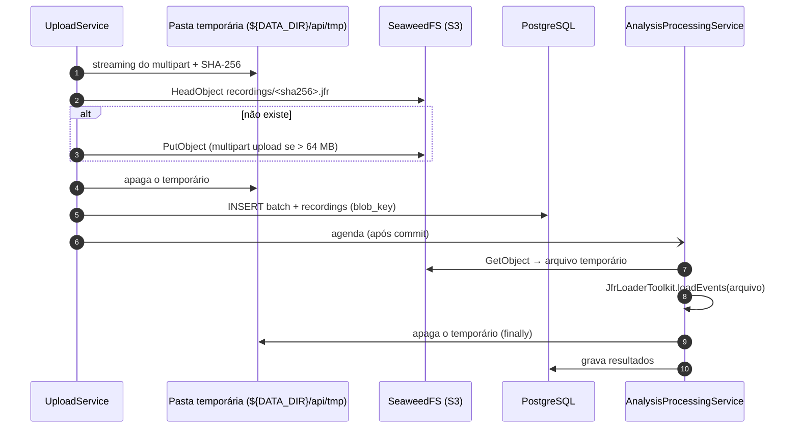

# Armazenamento blob

Voltar: [[00 Índice]] · Decisão: [[08 Decisões e questões#D-03 — Arquivo .jfr em blob storage (SeaweedFS)]]

> [!abstract] Resumo
> Os arquivos `.jfr` originais ficam num **container dedicado de blob storage**, o **SeaweedFS**, acessado pela **API S3**. Os dados do SeaweedFS ficam numa pasta da máquina real (*bind mount*), então nada se perde ao reiniciar ou recriar o container. Ver [[07 Infraestrutura e qualidade#Persistência no host]].

## Por que um container de blob

| Antes | Agora |
|---|---|
| Volume `jfr-storage` montado direto na `api` | Serviço `blob` próprio, separado da API |
| API e arquivos presos ao mesmo container | A API não guarda estado; dá para escalar ou trocar a API sem tocar nos arquivos |
| Acesso por caminho de arquivo | Acesso por bucket + chave (protocolo S3) |
| Troca de armazenamento exige mudar código | Qualquer servidor S3 (AWS S3, Garage, MinIO...) funciona só mudando a configuração |

O futuro `mcp` e o `ia` também vão ler o `.jfr` pelo blob, sem montar a pasta da API.

## SeaweedFS

- **Imagem**: `chrislusf/seaweedfs`, com **versão fixa** (nada de `latest`). A versão é definida no spike.
- **Licença**: Apache 2.0.
- **Modo**: `server -s3`, que sobe master, volume, filer e gateway S3 num processo só. É suficiente para a v0.1.0.
- **Dados**: `/data` dentro do container → `${DATA_DIR}/seaweedfs` no host.
- **Credenciais S3**: arquivo `s3.json`, montado somente leitura e gerado a partir de `BLOB_ACCESS_KEY` / `BLOB_SECRET_KEY` do `.env`. Nunca versionado com valores reais.
- **Portas**: `8333` (S3) **só na rede interna** do Compose. Para depurar no host, há um override opcional (`docker-compose.debug.yml`) que expõe a porta em `127.0.0.1`.

> [!warning] Validar no spike
> As flags exatas do `weed server` e o comando de health check do SeaweedFS precisam ser confirmados na versão fixada da imagem, junto com o spike do JMC ([[04 Extração JFR#Biblioteca]]).

## Organização dos objetos

| Item | Valor |
|---|---|
| Bucket | `${BLOB_BUCKET}` (padrão `jfr-recordings`), criado pela API na inicialização se não existir |
| Chave | `recordings/<sha256>.jfr` |
| Metadados | `original-name`, `sha256`, `uploaded-at` |
| Content-Type | `application/octet-stream` |

- **Deduplicação**: antes de enviar, a API faz `HeadObject`. Se a chave já existe, não envia de novo.
- **No banco** (`jfr_recording`): `blob_bucket`, `blob_key`, `sha256` e `size_bytes`. Ver [[05 Modelo de dados]].

## Integração na API

- **Biblioteca**: AWS SDK for Java v2 (`software.amazon.awssdk:s3`), com versão pelo BOM `software.amazon.awssdk:bom`.
- **Cliente**: um `S3Client` configurado em `system.config.BlobStorageConfig`:
  - `endpointOverride(${BLOB_ENDPOINT})`, por exemplo `http://blob:8333`;
  - `forcePathStyle(true)`;
  - região fixa `us-east-1`, que o SeaweedFS ignora;
  - `requestChecksumCalculation(WHEN_REQUIRED)` e `responseChecksumValidation(WHEN_REQUIRED)`.

> [!caution] Checksums do SDK
> A partir da 2.30, o SDK v2 envia checksums CRC por padrão. Vários servidores compatíveis com S3 rejeitam esses checksums. Por isso o cliente usa `WHEN_REQUIRED`, e há um teste de integração cobrindo isso.

- **Serviço**: `system.service.BlobStorageService`, com a interface:
  - `exists(key)`
  - `upload(key, Path, metadata)`
  - `downloadToTempFile(key) → Path`
  - `delete(key)`
  - `ensureBucket()`
- **Health**: `HealthIndicator` `blobStorage` com `HeadBucket`. Substitui o antigo `jfrStorage` em [[03 Requisitos#RF-09 — Health check]].

## Fluxo com o blob

> [!note] Por que baixar para um arquivo temporário?
> O carregador do JMC trabalha com arquivo local. O temporário fica em `${DATA_DIR}/api/tmp`, mapeado no host para não encher a camada do container, e é apagado no `finally`. Na inicialização, a API limpa temporários antigos.

## Falhas

| Situação | Comportamento |
|---|---|
| Blob fora do ar no upload | `503 STORAGE_UNAVAILABLE`, nada é persistido |
| Falha no `PutObject` de um arquivo do lote | Lote inteiro rejeitado (tudo ou nada, ver [[03 Requisitos#RF-01 — Upload de arquivos JFR]]). Objetos novos enviados nessa requisição são apagados. |
| Blob fora do ar no processamento | Gravação `FAILED` com `STORAGE_UNAVAILABLE` |
| Objeto não encontrado no processamento | Gravação `FAILED` com `BLOB_NOT_FOUND` |

## Testes

- **Unitários**: `BlobStorageService` com `S3Client` mockado.
- **Integração**: Testcontainers com `GenericContainer` do SeaweedFS, na mesma versão do Compose. Cobre bucket, put/head/get, deduplicação e checksum `WHEN_REQUIRED`.
